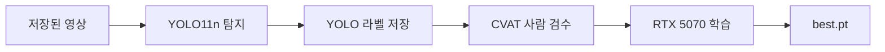

# 강아지 탐지

저장된 영상을 **YOLO11n**에 넣어 강아지 박스를 자동 라벨로 저장하고, **CVAT**에서 사람이 고친 뒤 **RTX 5070**에서 다시 학습합니다.



COCO로 학습된 `yolo11n.pt`의 `dog` 클래스가 1차 박스입니다. 호텔·켄넬 영상처럼 배포 환경이 다르면, 검수본으로 미세조정합니다.

이 개발 PC의 GPU는 **NVIDIA GeForce RTX 5070 Laptop**, 메모리 **8GB**, 드라이버 610.88, compute capability **12.0** (`sm_120`)입니다. `train.batch` 기본값 16은 이 메모리 기준입니다. 데스크톱 RTX 5070(12GB)이면 `config.yaml`의 `train.batch`를 32로 올리세요.

## 준비

- Python 3.11 이상 (설치 스크립트는 3.12를 받습니다)
- NVIDIA 드라이버 (Blackwell은 최신 Game Ready / Studio 드라이버)
- CVAT용 Docker Desktop
- 별도 CUDA 툴킷은 필요 없습니다. PyTorch 휠에 런타임이 들어 있습니다.

RTX 5070은 Blackwell이라 PyTorch 빌드에 `sm_120`이 있어야 합니다. `ultralytics`가 가져온 PyTorch에 그 아키텍처가 없으면 `gpu --fix`가 CUDA 12.8 휠로 바꿉니다. Ada(RTX 40xx, `sm_89`)는 공식 휠 목록에 `sm_89`가 없어도 `sm_86`으로 동작합니다.

## 설치

```powershell
cd apps\dog-detect
.\scripts\setup.ps1
```

스크립트는 `.env.example`을 `.env`로 복사하고, 패키지를 설치한 뒤 GPU를 확인합니다. 노트북은 전원을 연결한 상태에서 학습하세요.

## 1. 탐지와 자동 라벨

영상을 `data\videos`에 넣습니다. mp4, avi, mov, mkv, webm, m4v를 읽습니다.

```powershell
python -m dog_detect detect
```

동작은 다음과 같습니다.

- 초당 `sample_fps`(기본 1) 프레임만 후보로 둡니다.
- 화면 변화가 `min_frame_diff`보다 작으면 추론을 건너뛰고, 그래도 `max_gap_seconds`(기본 5초)마다 한 번은 추론합니다.
- `dog` 박스만 남기고, 너무 작은 박스는 버립니다.
- 프레임은 `data\autolabel\images`, 라벨은 `data\autolabel\labels`에 YOLO 형식(`0 cx cy w h`, 클래스 0 = dog)으로 저장합니다.
- 이미 있는 파일은 다시 쓰지 않습니다. 설정을 바꿔 다시 만들려면 `data\autolabel` 내용물을 지우세요.

첫 실행에서 Ultralytics가 `yolo11n.pt`를 내려받습니다.

## 2. CVAT에서 사람 검수

```powershell
.\scripts\up-cvat.ps1
docker exec -it cvat_server python manage.py createsuperuser
```

만든 계정으로 `.env`의 `CVAT_HOST`, `CVAT_USERNAME`, `CVAT_PASSWORD`(또는 `CVAT_ACCESS_TOKEN`)를 채웁니다. CVAT 버전 기본값은 `v2.79.0`이고, `CVAT_REF`로 바꿀 수 있습니다.

```powershell
python -m dog_detect cvat-push
```

프로젝트 `pet-dog-detect`와 라벨 `dog`를 만들고, 이미지를 태스크로 올린 다음 **YOLO 1.1** 자동 라벨을 넣습니다. 이미지가 `chunk_size`(기본 400)를 넘으면 태스크를 나눕니다. 출력된 URL에서 박스를 수정·삭제·추가합니다.

검수가 끝나면 학습 폴더로 내려받습니다.

```powershell
python -m dog_detect cvat-pull
```

`Ultralytics YOLO Detection 1.0`으로 받아 `data\reviewed\dataset\data.yaml`을 만듭니다. train/val 분할은 `train.val_ratio`와 `train.seed`로 고정됩니다. `cvat-push`를 다시 실행하면 새 태스크가 생기고, `cvat_task.json`은 마지막 업로드를 가리킵니다. 이전 태스크는 CVAT에 남아 있습니다.

## 3. RTX 5070 학습

```powershell
python -m dog_detect train
```

검수본이 있을 때만 학습합니다. GPU 이름에 5070이 있고 PyTorch가 `sm_120`을 포함해야 합니다. 결과는 `runs\dog-yolo11n\weights\best.pt`입니다. 다음 탐지에 쓰려면 `config.yaml`의 `detect.model`을 그 경로로 바꿉니다.

검수 전 파이프라인을 시험할 때만:

```powershell
python -m dog_detect train --from-autolabel
```

상태 확인:

```powershell
python -m dog_detect status
python -m dog_detect gpu
```

## 폴더

| 경로 | 내용 |
| --- | --- |
| `data/videos` | 입력 영상 |
| `data/autolabel` | 자동 라벨, `manifest.jsonl`, `cvat_task.json` |
| `data/reviewed/dataset` | 검수 후 학습 세트 (`data.yaml`) |
| `runs/dog-yolo11n` | 학습 로그와 `weights/best.pt` |
| `.cvat` | CVAT 소스 클론 (깃에 넣지 않음) |

CVAT를 멈추려면 `.\scripts\down-cvat.ps1`을 실행합니다.

## 메모리가 부족할 때

5070 Laptop은 약 8GB입니다. 학습이 메모리 부족으로 끝나면 `config.yaml`의 `train.batch`를 8로 내리세요. 데스크톱 12GB에서는 32까지 올릴 수 있고, `-1`이면 Ultralytics가 배치를 잡습니다.
