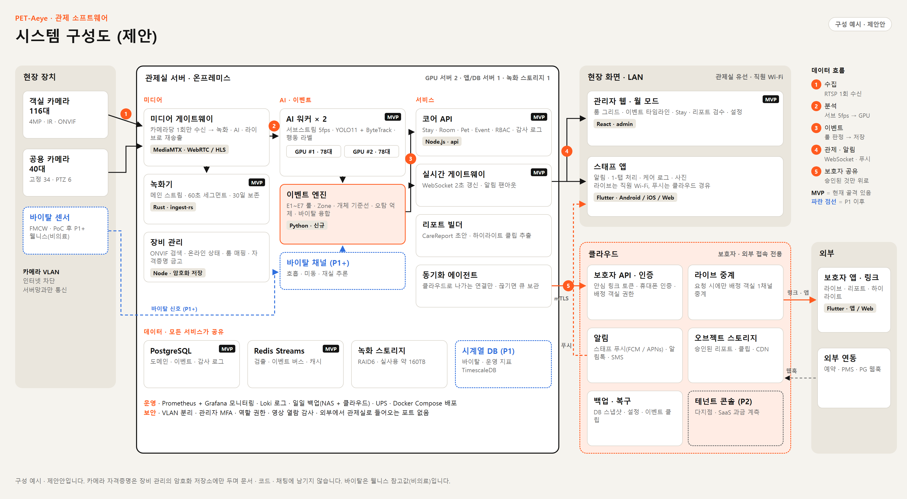

# PET-Aeye 관제 소프트웨어 시스템 구성 (제안 v0.1)

> 대상: 파우코리아 펫호텔 영종 — 카메라 156대(객실 116 · 공용 40) · 2026.10 · 내부 논의용  
> 기준: 현재 MVP(`peti-mvp`: Rust 수집 · Python AI 워커 · Node API · React 관리자 · PostgreSQL · Redis)를 확장하는 방향입니다.  
> 관련: 앱 기능 명세 덱 `PLAN_PET-Aeye_apps_spec_v0.2.pptx` · 비용 산정 `PET-Aeye_CCTV_서버_비용산정_초안.md` · 리트로핏 `PET-Aeye_리트로핏_설치계획_초안.md`

원본: `_mockups/arch_system.html` (Chrome 헤드리스로 렌더)

---

## 1. 설계 원칙

1. **관제는 현장에서 끝납니다.** 영상 수집 · 녹화 · AI · 관제 화면은 관제실 서버에서 돌아가며, 인터넷이 끊겨도 관제와 녹화는 계속됩니다.
2. **카메라는 한 번만 받습니다.** 미디어 게이트웨이가 카메라당 1회 수신해 녹화 · AI · 라이브로 나눠 줍니다. 카메라 동시 접속 제한과 대역폭 낭비를 피합니다.
3. **판단은 이벤트 엔진 한 곳에서 합니다.** AI 워커는 "무엇이 보이는지"만 내보내고, "알릴지 말지"는 이벤트 엔진이 룰 · Zone · 개체 기준선으로 정합니다. 오탐 튜닝을 한 곳에서 할 수 있습니다.
4. **클라우드에는 승인된 것만 올라갑니다.** 관제실에서 클라우드로 나가는 연결만 열고, 외부에서 관제실로 들어오는 포트는 두지 않습니다. 보호자에게는 배정 객실 라이브와 매니저가 승인한 리포트만 전달됩니다.
5. **MVP 코드를 버리지 않습니다.** 녹화기(ingest-rs) · AI 워커 · 코어 API · 관리자 웹은 그대로 키우고, 장비 관리 · 미디어 게이트웨이 · 이벤트 엔진 · 클라우드 계층을 더합니다.

---

## 2. 구성 요소

| 계층 | 구성 요소 | 역할 | 기술 (안) | MVP | 관련 기능 |
|------|-----------|------|-----------|-----|-----------|
| 미디어 | 미디어 게이트웨이 | 카메라당 1회 RTSP 수신 → 녹화 · AI · 라이브(WebRTC / HLS) 재송출 | MediaMTX | 신규 | A-01 · A-05 · S-03 · G-02 |
| 미디어 | 녹화기 | 메인 스트림 60초 세그먼트 저장 · 보존 정책 · 재생 인덱스 | Rust (ingest-rs 확장) | 있음 | A-05 |
| 미디어 | 장비 관리 | ONVIF 검색 · 온라인 상태 · 룸 매핑 · 카메라 자격증명 암호화 저장 | Node (API 모듈) | 신규 | A-06 |
| AI | AI 워커 × 2 | 서브스트림 5fps · YOLO11 검출 + ByteTrack 추적 · 행동 라벨 | Python · TensorRT | 있음 (단일 카메라) | A-02 |
| AI | 이벤트 엔진 | E1~E7 룰 · Zone · 개체 기준선 · 지속 시간 판정 · 오탐 억제 · 바이탈 융합 | Python | 신규 | A-04 · A-11 · S-02 |
| AI | 바이탈 채널 (P1+) | FMCW 센서 신호 → 호흡 · 미동 · 재실 추론 (웰니스) | Python | 신규 | A-07 · S-08 · G-03 |
| 서비스 | 코어 API | Stay · Room · Pet · Event · CareLog · Report 도메인 · RBAC · 감사 로그 | Node.js (TypeScript) | 있음 (골격) | 전 화면 |
| 서비스 | 실시간 게이트웨이 | WebSocket 2초 갱신 · 알림 팬아웃 · 처리 상태 동기화 | Node · Redis Pub/Sub | 있음 | A-04 · S-02 |
| 서비스 | 리포트 빌더 | CareReport 초안 · 하이라이트 클립 추출 · 졸업 리포트 집계 | Python · FFmpeg | 신규 | A-10 · G-04 ~ G-06 |
| 서비스 | 동기화 에이전트 | 클라우드로 나가는 연결 유지 · 승인 데이터 전송 · 끊기면 큐 보관 | Node · mTLS | 신규 | G 전체 |
| 데이터 | PostgreSQL | 도메인 · 이벤트 · 감사 로그 | PostgreSQL 16 | 있음 | — |
| 데이터 | Redis Streams | 검출 · 이벤트 버스 · 캐시 | Redis 7 | 있음 | — |
| 데이터 | 녹화 스토리지 | RAID6 · 실사용 약 160TB · 30일 보존 | 파일 시스템 | 신규 | — |
| 데이터 | 시계열 DB (P1) | 바이탈 · 운영 지표 | TimescaleDB | 신규 | A-07 · A-14 |
| 클라우드 | 보호자 API · 인증 | 안심 링크 토큰 · 휴대폰 인증 · 배정 객실 권한 확인 | Node.js | 신규 | G-01 · G-10 |
| 클라우드 | 라이브 중계 | 보호자 요청 시에만 배정 객실 1채널을 중계 | MediaMTX / WebRTC | 신규 | G-02 |
| 클라우드 | 알림 | 스태프 푸시(FCM / APNs) · 카카오 알림톡 · SMS | 외부 API | 신규 | S-02 · G-07 · G-15 |
| 클라우드 | 오브젝트 스토리지 | 승인된 리포트 · 클립 · CDN | S3 호환 | 신규 | G-04 ~ G-06 |
| 클라우드 | 테넌트 콘솔 (P2) | 다지점 · SaaS 과금 계측 | — | 신규 | A-15 |
| 화면 | 관리자 웹 · 월 모드 | 관제 · Stay · 리포트 검수 · 설정 | React (admin 확장) | 있음 | A-01 ~ A-20 |
| 화면 | 스태프 앱 | 알림 · 처리 · 케어 로그 · 사진 | Flutter (Android 우선 · iOS · Web) | 신규 | S-01 ~ S-17 |
| 화면 | 보호자 앱 · 링크 | 라이브 · 리포트 · 하이라이트 | Flutter (안심 링크 = Flutter Web · 앱 = Android / iOS) | 신규 | G-01 ~ G-17 |

---

## 3. 데이터 흐름

| # | 흐름 | 경로 | 목표 |
|---|------|------|------|
| ① | 수집 | 카메라 → 미디어 게이트웨이 (메인 · 서브 2스트림) → 녹화기 | 카메라당 1회 수신 · 녹화 무중단 |
| ② | 분석 | 게이트웨이 서브스트림 5fps → AI 워커(카메라 절반씩 분담) → 검출 결과를 Redis Streams로 | 초당 약 780프레임 처리 |
| ③ | 이벤트 | 이벤트 엔진이 검출 + 바이탈을 룰로 판정 → PetEvent 저장(PostgreSQL) | 룰 · 임계값 한 곳에서 관리 |
| ④ | 관제 · 알림 | 실시간 게이트웨이 → 관리자 웹(WebSocket) · 스태프 앱(LAN WebSocket + 클라우드 푸시) | 라이브 2초 · 알림 5초 이내 |
| ⑤ | 보호자 공유 | 매니저 승인 리포트 · 클립 → 동기화 에이전트 → 클라우드 → 보호자 / 라이브는 요청 시 배정 객실만 중계 | 승인 전 데이터 외부 반출 없음 |

**알림 5초 목표 시간 배분 (지속 시간 조건 충족 이후 기준)**

| 구간 | 예상 |
|------|------|
| 카메라 → 게이트웨이 → AI 프레임 | 약 0.5초 |
| 추론 · 추적 | 약 0.1초 |
| 이벤트 판정 · 저장 | 약 0.5초 |
| WebSocket 전달 (관리자 · LAN 스태프) | 약 0.2초 |
| 클라우드 푸시 (FCM / APNs) | 약 1~3초 |
| **합계** | **약 2.5~4.5초** |

"25분 이상 연속 활동" 같은 지속 시간 조건을 채우는 시간은 판정 대기 시간이라 위 합계에 넣지 않았습니다.

---

## 4. 서버 배치 (비용 산정 기준 장비 4대)

| 서버 | 올라가는 구성 요소 | 비고 |
|------|---------------------|------|
| 녹화 스토리지 서버 | 미디어 게이트웨이 · 녹화기 · 재생 | 메인 스트림(약 312Mbps)이 디스크 옆에서 끝나도록 배치 |
| GPU 서버 #1 | AI 워커(카메라 78대) · 이벤트 엔진(주) | |
| GPU 서버 #2 | AI 워커(카메라 78대) · 이벤트 엔진(대기) · 리포트 빌더 | 장애 시 156대 전체 인계 |
| 앱 · DB 서버 | 코어 API · 실시간 게이트웨이 · 장비 관리 · 동기화 에이전트 · PostgreSQL · Redis · 모니터링 | 매일 백업 NAS + 클라우드 백업 |

서버 사이는 10G 코어 스위치로 연결합니다. 배포는 서버마다 Docker Compose로 하고, 설정은 Ansible로 관리합니다(다지점이 되면 k3s 검토).

---

## 5. 네트워크 구역

| 구역 | 포함 | 통신 허용 |
|------|------|-----------|
| 카메라 VLAN | 카메라 156대 · 바이탈 센서 | 미디어 게이트웨이 · 장비 관리로만. 인터넷 차단 |
| 서버 VLAN | 서버 4대 · 백업 NAS | 카메라 VLAN 수신 · 관리 VLAN · 클라우드로 나가는 연결만 |
| 관제 VLAN | 관제실 PC · 월 모니터 | 서버 VLAN의 관리자 웹 · 라이브 |
| 직원 Wi-Fi | 스태프 단말 | 코어 API · 실시간 게이트웨이 · 라이브(담당 구역). 단말 등록제 |
| 손님 Wi-Fi | 로비 · 카페 | 인터넷만. 내부망 접근 불가 |

카메라 자격증명은 장비 관리의 암호화 저장소에만 둡니다. 현재 MVP처럼 `.env`에 RTSP 주소를 두는 방식은 1단계에서 없앱니다.

---

## 6. 장애 시 동작

| 장애 | 계속되는 것 | 영향 · 대응 |
|------|-------------|-------------|
| 인터넷 끊김 | 관제 · 녹화 · AI · 스태프 앱(직원 Wi-Fi) | 스태프 푸시 대신 LAN WebSocket 알림 유지 · 보호자 라이브 · 리포트 지연 · 동기화 큐 보관 후 재전송 |
| GPU 서버 1대 장애 | 녹화 · 라이브 · 나머지 GPU | 남은 1대가 156대 인계(필요 시 5fps → 3fps) · 관제 화면에 "AI 성능 저하" 표시 |
| 미디어 게이트웨이 장애 | 관리자 웹 · 이벤트 기록 | 녹화 · 라이브 중단 → 장비 경고(E5) · 최우선 복구. AI 워커는 카메라에서 서브스트림 직접 수신으로 대체 |
| 앱 · DB 서버 장애 | 녹화 · AI 검출 | 관제 화면 중단 → 게이트웨이 직접 라이브(읽기 전용)로 임시 관제 · 백업 스냅샷 복원 목표 1시간 |
| 정전 | UPS 동안 전체 | 15~30분 유지 후 순차 정상 종료 · 복전 시 자동 기동 |
| 카메라 1대 끊김 | 나머지 전체 | 장비 오프라인 이벤트(E5) · 해당 객실 대체 순찰 SOP |

---

## 7. 기술 선택 근거 · 대안

| 영역 | 제안 | 이유 | 대안 |
|------|------|------|------|
| 미디어 게이트웨이 | MediaMTX | 오픈소스 · RTSP / WebRTC / HLS 재송출 · 라이선스비 없음 | go2rtc · 상용 VMS(카메라당 라이선스) |
| 녹화 | ingest-rs 확장 | MVP 코드 재사용 · 세그먼트 구조 이미 있음 | 상용 NVR · Frigate |
| AI 추론 | YOLO11 + ByteTrack + TensorRT | MVP 모델 그대로 · GPU 1장이 전량 처리 가능 | NVIDIA DeepStream(대량 스트림 효율 ↑, 학습 비용 ↑) |
| 이벤트 버스 | Redis Streams | 단일 지점 규모에 충분 · MVP에 이미 있음 | NATS · Kafka (다지점 이후) |
| API | Node.js (TypeScript) + OpenAPI 명세 | MVP와 같은 언어 · OpenAPI에서 Dart 클라이언트 자동 생성 | — |
| DB | PostgreSQL 16 (+ TimescaleDB P1) | 도메인 · 이벤트 · 시계열을 한 엔진으로 | 별도 시계열 DB |
| 스태프 · 보호자 앱 | **Flutter (확정)** | 한 코드로 Android · iOS · Web 빌드 · 스태프 / 보호자 공통 모듈 공유 | — |
| 보호자 안심 링크 | Flutter Web | 앱과 같은 화면 코드 · 설치 없는 링크가 P0 | — |
| 관리자 웹 | React (MVP 유지) | 월 모드 대량 그리드 · MVP 화면 재사용 | Flutter Web 이전(§8 참고) |
| 클라우드 | 국내 리전 (NCP 또는 AWS 서울) | 영상 · 개인정보 국내 보관 | — |
| 모니터링 | Prometheus · Grafana · Loki | 오픈소스 표준 · 카메라 · GPU · 디스크 지표 수집 | 상용 APM |

---

## 8. 앱 클라이언트 구성 (Flutter · 웹 + 앱 크로스 플랫폼)

스태프 앱과 보호자 앱은 **Flutter 하나의 저장소(모노레포)** 로 만들고, 같은 코드에서 Android · iOS · Web을 빌드합니다. Android를 먼저 출시합니다.

| 패키지 | 내용 | 빌드 대상 |
|--------|------|-----------|
| `core` | API 클라이언트(OpenAPI → Dart 자동 생성) · 인증 · 도메인 모델 · WebSocket · 오류 / 빈 화면(C-05) · 다국어(C-12) | 공통 |
| `ui_kit` | 디자인 토큰 · 상태 칩 · 바이탈 바 · 라이브 플레이어 · "구성 예시 / 웰니스(비의료)" 표기 컴포넌트 | 공통 |
| `staff_app` | 알림 · 처리 · 케어 로그 · 객실 · 교대 (S-01 ~ S-17) | Android · iOS · Web(관제실 보조) |
| `guardian_app` | 실시간 · 리포트 · 하이라이트 · 예약 · 내 정보 (G-01 ~ G-17) | Android · iOS · **Web(안심 링크)** |

| 영역 | 선택 (안) | 비고 |
|------|-----------|------|
| 상태 관리 | Riverpod | 화면 · 모듈 단위 테스트 용이 |
| 라우팅 · 딥링크 | go_router | 푸시 · 안심 링크 URL → 같은 화면 경로(C-04) |
| 라이브 영상 | flutter_webrtc | Android · iOS · Web 모두 지원 → **보호자 라이브는 WebRTC로 정리** (HLS는 Web에서 별도 플레이어 필요) |
| 푸시 | Firebase Cloud Messaging | Android · iOS 푸시 · Web 알림(선택) |
| 오프라인 저장 | 로컬 DB (drift 또는 Isar) | 케어 로그 임시 저장 후 동기화(C-08) |
| 촬영 | camera 패키지 · 앱 내 저장소 | 갤러리 미저장(S-14) |
| 인증 저장 | flutter_secure_storage | 토큰 · PIN(공용 단말 C-01 · S-17) |

**Flutter Web(안심 링크) 유의점**

- 첫 로딩이 일반 웹보다 무겁습니다(엔진 다운로드). 링크 첫 화면은 가볍게 만들고, 리포트 · 하이라이트는 지연 로딩(deferred import)으로 나눕니다. CDN 캐시로 두 번째 접속부터 빠르게 합니다.
- 검색 노출은 필요 없는 화면이라(기간 한정 · 토큰 링크) SEO 단점은 영향이 없습니다.
- 목표: 안심 링크 첫 화면 표시 3초 이내(LTE 기준) — 수용 기준에 추가합니다.

**관리자 웹은 React를 유지합니다.** 월 모드의 대량 라이브 그리드는 이미 MVP React 화면이 있고 브라우저 영상 처리에 유리합니다. 관리자까지 Flutter Web으로 통일할지는 P1 이후 스태프 앱 Web 빌드 경험을 보고 판단합니다.

---

## 9. MVP → 목표 구성 전환 단계

| 단계 | 시기 | 작업 | 대응 기능 |
|------|------|------|-----------|
| 1단계 · P0 | 오픈 D-60 ~ D-30 | 장비 관리(카메라 등록 · 자격증명 금고, `.env` 단일 RTSP 제거) · 미디어 게이트웨이 도입 · AI 워커 다중 카메라 + 분담 · 이벤트 엔진 분리(E1 · E2 · E4 · E5) · Room / Stay / Pet 도메인 · 관리자 룸 그리드 · Flutter 모노레포(core · ui_kit) 셋업 · 스태프 앱 Android 알림 · 보호자 안심 링크(Flutter Web) · 클라우드 최소 구성(보호자 API · 라이브 중계 · 알림톡) | A-01~06 · S-01~07 · G-01 · 02 · 04 · 10 |
| 2단계 · P1 | 오픈 ~ +3개월 | 리포트 빌더 · 졸업 리포트 · 오브젝트 스토리지 · 바이탈 채널 + 시계열 DB · 알림 규칙 화면 · 모니터링 고도화 · 보호자 앱 Android / iOS 스토어 출시 · 스태프 앱 iOS | A-07~13 · S-08~11 · G-03 · 05~09 |
| 3단계 · P2 | +6개월 ~ | 테넌트 콘솔 · 다지점 · 배포 k3s 전환 · 메시지 버스 교체 검토 · SaaS 과금 계측 | A-14 · A-15 · G-11 · G-12 |

---

## 10. 결정 사항

- [x] 스태프 · 보호자 앱: **Flutter** (웹 + 앱 크로스 플랫폼 · Android 우선) — 2026-10-17
- [x] 보호자 라이브 방식: **WebRTC** (Flutter 3개 플랫폼 공통 지원) — Flutter 결정에 따름
- [ ] 녹화를 자체 녹화기(ingest-rs)로 갈지, 상용 NVR / VMS를 병행할지 — 개발 부담과 라이선스비 비교
- [ ] 클라우드 사업자: NCP vs AWS 서울 리전
- [ ] 관리자 웹: React 유지 vs Flutter Web 통일 (P1 이후 판단)
- [ ] 녹화 보존 기간 30일 / 14일 (스토리지 사양 · 비용 산정과 연동)

*이 문서는 제안 초안입니다. 현장 실측과 1단계 개발 착수 전에 갱신합니다.*
