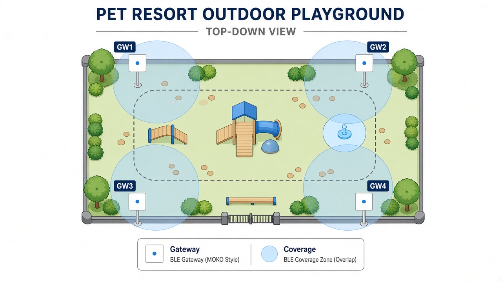
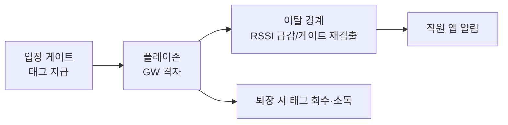
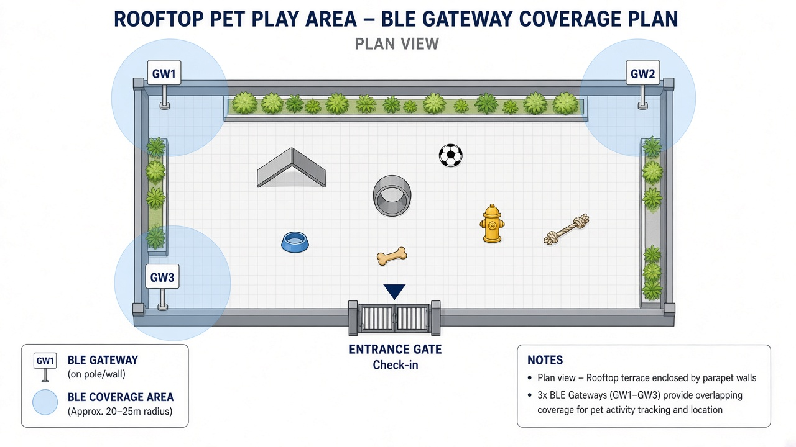
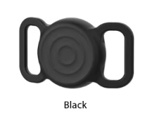
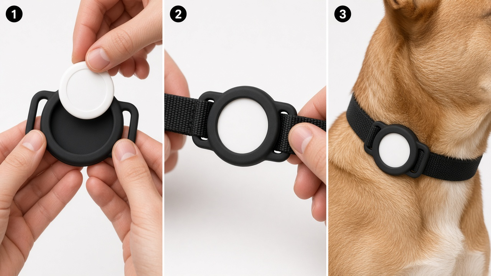

# PET-Aeye 넓은 공간 BLE 개체 추적 (초안 v0.2)

> 대상: 지상 플레이그라운드 · 옥상 루프탑 · 어질리티 · 광장 등 **넓은 공용 운동 공간**  
> 제품: **Minew MWB01** (목줄 태그) + **MOKO MKGW1-BW** (BLE 게이트웨이)  
> 연계: `PET-Aeye_횡성펫리조트_카메라_구성_초안.md` · `PET-Aeye_CCTV_서버_비용산정_초안.md` · 마스터 기획서  
> 단위: 만원 · VAT 별도 · **가정치**. 현장 실측 · 견적으로 확정합니다.  
> **v0.1**: 입장 시 목줄 태그 지급 · 게이트웨이 격자 배치 · 카메라 비전과 역할 분담.  
> **v0.2**: 실리콘 케이스를 **목줄 관통·몸쪽 밀착형**으로 확정(매달림·클립형 배제) — 상대견 물어뜯김 완화.

---

## 1. 왜 BLE 태그를 쓰는가

실내 객실·복도는 NPU 카메라 비전 추적만으로 충분합니다.  
**지상 플레이그라운드 · 옥상 루프탑**처럼 면적이 넓고 개체가 많고 · 원거리 · 부분 가림이 잦은 공간에서는 비전만으로 개체 ID를 유지하기 어렵습니다.

| 방식 | 역할 | 한계 |
|------|------|------|
| NPU / 실외 CCTV + 엣지 | 행동 · 포즈 · 이상행동 · 보안 녹화 | 넓은 야외에서 동일 개체 ID 유지가 어려움 |
| **BLE 태그 (본 문서)** | **입장~퇴장 동안 개체 ID · 구역 체류 · 이탈 감지** | 위치는 게이트웨이 RSSI 수준(수 m~십수 m), cm급 측위 아님 |

**운영 원칙:** 플레이 공간 **입장 시** 직원이 MWB01을 **목줄에 끼운 실리콘 케이스**(몸쪽 밀착)에 넣어 착용시키고, **퇴장 시** 회수·소독합니다. 카메라는 행동을, BLE는 “어느 개가 어느 구역에 있는지”를 맡습니다.

---

## 2. 하드웨어

### 2.1 태그 — Minew MWB01

| 항목 | 사양 |
|------|------|
| 형태 | Φ31 × 9.2 mm · 약 6.7 g · **AirTag와 동일 폼팩터** |
| 통신 | Bluetooth LE 5.0 · iBeacon / Eddystone |
| 방수 | **IP67** (야외 · 물놀이 후 소독에 적합) |
| 배터리 | CR 교체형 · 기본 설정 약 8개월 (가속도 절전) |
| 부가 | NFC · OTA · BeaconSET+ 설정 |
| 방송 거리 | 개활지 최대 약 80 m (게이트웨이·장애물에 따라 실효 거리는 짧음) |

**착용:** AirTag 호환 **목줄 관통형 실리콘 케이스**에 넣어 목줄에 끼웁니다(매달림·키링형 금지 · §4).

### 2.2 게이트웨이 — MOKO MKGW1-BW (Pro)

| 항목 | 사양 |
|------|------|
| 역할 | BLE 광고 패킷 스캔 → Wi-Fi / Ethernet으로 서버 업로드 (MQTT / HTTP 등) |
| BLE | Bluetooth 5.0 · 스캔 개활지 최대 약 120~150 m (1M PHY) |
| 네트워크 | Wi-Fi 802.11 b/g/n · 10/100 Ethernet · **PoE(802.3af)** |
| 크기 | 120 × 120 × 22.5 mm · 벽/천장 설치 |
| 보호등급 | **IP20 (실내용)** → 야외·루프탑은 **방수함 + 차양** 필수(§3.3) |
| 전원 | PoE 우선 · 대안 DC 9–15V / Micro USB 5V |

### 2.3 PET-Aeye 연동 (역할 분담)

```
[MWB01 목줄 태그] --BLE 광고--> [MKGW1-BW × N대]
                                      |
                                 MQTT/HTTP
                                      v
                         [PET-Aeye 수집 · 위치 서비스]
                                      |
              +-----------------------+-----------------------+
              v                       v                       v
        관제 웹(구역 맵)          직원 앱(이탈·체류)        보호자 앱(플레이 중 위치 요약)
              |
              +---- 동일 pet_id / stay_id ----> [카메라 이벤트 · 클립]
```

| 계층 | 담당 |
|------|------|
| ODM/벤더 | MWB01 광고 · MKGW1-BW 스캔·포워딩 |
| PET-Aeye | 태그↔예약/개체 바인딩 · RSSI 구역 판정 · 이탈 알림 · 카메라 이벤트와 ID 조인 |

---

## 3. 설치 방법 (지도 · 도표)

### 3.1 배치 원칙

| 원칙 | 내용 |
|------|------|
| 격자 커버리지 | 개활지 실효 반경을 **약 25~35 m**로 잡고 원이 겹치게 배치 (스펙 최대치의 1/3~1/2) |
| 높이 | 지면/바닥 기준 **2.5~4 m** (목줄 높이 RSSI가 안정적인 구간) |
| 전원 · 통신 | PoE 유선 우선 · AP 전용 SSID는 백업 |
| 출입구 | 입장 게이트에 **GW를 1대 이상** 두어 체크인/체크아웃 RSSI 급변을 잡음 |
| 사각 | 철제 펜스·콘크리트 벽 뒤는 추가 GW 또는 중계 지점 |

**수량 가이드 (가정치):**

| 공간 | 면적 가정 | GW 대수 | 비고 |
|------|-----------|---------|------|
| 지상 플레이그라운드 | 약 1,500~2,500 ㎡ | **4~6대** | 모서리 + 변 중앙 · 입장구 1대 포함 |
| 옥상 루프탑 | 약 400~800 ㎡ | **3~4대** | 난간·기둥 고정 · 방수함 |
| 어질리티 · 산책 광장 | 구역당 | **2~4대** | 선형 공간은 30 m 간격 |

### 3.2 지상 플레이그라운드 배치도



| 기호 | 의미 |
|------|------|
| GW1~GWn | MKGW1-BW (방수함 장착) |
| 원형 음영 | 실효 커버리지(겹침 = 다중 GW RSSI로 구역 판정) |
| Entrance | 입장·태그 지급/회수 포인트 |

**설치 순서**

1. 배치도에 GW 후보점 표시 → 현장 RF 서베이(태그 들고 산책하며 RSSI 맵)
2. 폴·벽면 브래킷 + **옥외 방수함** 고정 · PoE 케이블 인입
3. 게이트웨이 MQTT 토픽 → PET-Aeye 수집 엔드포인트 등록
4. 입장구 GW를 `zone=gate`로 지정해 체크인/아웃 이벤트 분리



### 3.3 옥상 루프탑 배치도



| 항목 | 루프탑 주의 |
|------|-------------|
| 방수 | MKGW1-BW는 IP20 → **IP65 이상 함체** · 케이블 그랜드 · 통기/결로 대책 |
| 햇빛 | 직사광 차양 · 내부 온도 −20~45 ℃ 범위 유지 |
| 난간 | 추락·강아지 물기 방지 높이 · 함체는 손 닿지 않는 위치 |
| 바람 | 폴 고정 시 풍압·진동 고려 (횡성·영종 모두 노천) |
| Wi-Fi | 루프탑 AP 음영 시 **Ethernet/PoE 필수** |

### 3.4 영종(옥상) · 횡성(지상) 적용

| 사이트 | 공간 | 카메라 | BLE |
|--------|------|--------|-----|
| 영종 펫호텔 | 옥상 놀이방 · 루프탑 | 기존 NPU/실외 CCTV | GW 3~4대 + 태그 풀 |
| 횡성 펫 리조트 | 펫 플레이그라운드 · 어질리티 · 광장 | 시중 실외 CCTV + 엣지 | GW 4~6대/구역 + 태그 풀 |

비전(행동)과 BLE(ID·구역)를 **같은 stay_id**로 묶습니다. BLE만으로 이상행동을 판단하지 않습니다.

---

## 4. 목줄 장착 — 관통·몸쪽 밀착형 실리콘 케이스

### 4.1 왜 매달림형을 쓰지 않는가

공용 플레이존에서는 **다른 개가 실리콘 커버를 물어뜯을 수 있습니다.**  
키링·클립으로 목줄 아래에 **늘어뜨리는** 형태는 물기·걸림·분실 위험이 커서 채택하지 않습니다.

| 형태 | 판정 | 이유 |
|------|------|------|
| **목줄 관통형 (기준)** | **채택** | 목줄 띠가 케이스 양옆 루프를 지나감 → 태그가 **목줄·몸쪽에 밀착** · 돌출·흔들림 최소 |
| 키링·클립 매달림형 | **금지** | 상대견 물어뜯기 · 놀이 중 걸림 · 분실 |
| 금속 케이스 | 비권장 | BLE 신호 감쇠 |
| 발목·하네스만 | 비권장 | 벗겨짐 · 자세에 따라 신호 불안정 |

### 4.2 기준 케이스 형태 (첨부 참고)

AirTag(및 동일 폼팩터 MWB01)용 **슬라이드 온 실리콘 케이스**: 중앙 원형 포켓 + **좌우 일체형 루프**에 목줄 띠를 관통.



| 항목 | 기준 |
|------|------|
| 재질 | 실리콘 (유연 · 소독 가능) |
| 구조 | 원형 태그 포켓 + **양옆 관통 루프** (목줄 띠 통과) |
| 장착 위치 | 목줄 **안쪽(목·가슴 쪽)** 또는 띠에 밀착 — 바깥으로 튀어나오지 않게 |
| 호환 | AirTag 사이즈 · **MWB01 Φ31 mm** |
| 참고 상품군 | Waterproof / luminous AirTag pet holder · collar slide-on (Alibaba 등 B2B) |

> 구매 시 **“collar slide / loop through / for dog collar”** 인지 확인하고, 키링 전용 SKU는 제외합니다.

### 4.3 장착 순서 (체크인)



| 단계 | 직원 작업 |
|------|-----------|
| 1 | 소독된 **MWB01**을 실리콘 케이스 원형 포켓에 끼움 |
| 2 | 목줄 버클을 풀고 띠를 케이스 **좌→우 루프에 관통** → 버클 잠금 (케이스가 몸쪽으로 붙도록) |
| 3 | 흔들림·뒤집힘 확인 · 필요 시 목줄 길이·위치를 턱 아래~가슴 쪽으로 조정 |
| 4 | 앱에서 **태그 MAC ↔ 예약·개체** 바인딩 후 플레이존 입장 |
| 5 | 퇴장 시 목줄에서 케이스 분리 → 태그·케이스 세척·소독 → 배터리 점검 후 보관함 |

시설 **공용 목줄**에 케이스를 미리 끼워 두고 태그(MWB01)만 교체하는 방식도 가능합니다(소독 동선 필수).

### 4.4 소모품 · 내구 (가정치)

| 품목 | 사양 | 비고 |
|------|------|------|
| 실리콘 케이스 | AirTag 호환 · **목줄 관통형** · 검정/다색 | 물림·찢김 대비 여분 **40%** |
| 목줄 | 띠 폭이 루프에 맞는 시설 공용 목줄 권장 | 너무 두꺼운 목줄은 루프 호환 샘플로 확인 |
| 분실·파손 | 물어뜯긴 케이스는 폐기 · 태그 MAC 즉시 비활성화 | IP67 태그와 별개로 **케이스 소모품** 관리 |

---


## 5. 운영 플로우

| 시점 | 행위 | 시스템 |
|------|------|--------|
| 체크인(호텔) | 예약에 개체 등록 | PMS / PET-Aeye |
| 플레이존 입장 | 태그 지급 · 바인딩 · 게이트 통과 | BLE `zone=gate` + 직원 앱 |
| 플레이 중 | 구역 체류 · 혼잡도 · 경계 이탈 | 다중 GW RSSI |
| 이상행동 | 카메라 이벤트 발생 시 BLE ID로 개체 확정 | 비전 + BLE 조인 |
| 퇴장 | 태그 회수 · 바인딩 해제 · 소독 | 직원 앱 |

---

## 6. 비용 스케치 (가정치 · 구역당)

| 항목 | 단가 가정 | 수량 예 (플레이존 1곳) | 소계 |
|------|-----------|------------------------|------|
| MWB01 태그 | 1.5만 | 80개 (동시 입장 피크 + 여분) | 120 |
| 목줄 관통형 실리콘 케이스 | 0.4만 | 120개 (물림 여분) | 48 |
| MKGW1-BW | 18만 | 5대 | 90 |
| 옥외 방수함 · 폴 · PoE 공사 | 25만/지점 | 5 | 125 |
| 수집·바인딩 SW (공통) | — | 사이트 공통 | 앱 개발에 포함 |
| **구역당 합계** | | | **약 383** |

- 영종 루프탑 1곳 + 횡성 플레이존 1곳 ≈ **약 0.08억** 수준(가정치).  
- 카메라·엣지 박스 비용과는 **별도** 라인입니다.

---

## 7. 설계 · 구매 체크리스트

- [ ] 플레이존 · 루프탑 도면에 GW 후보점 · PoE 관로 반영
- [ ] 옥외 방수함(IP65+) · 차양 · 설치 높이 확정
- [ ] MWB01 대량 견적 · BeaconSET+ 일괄 프로비저닝 절차
- [ ] **목줄 관통형** 실리콘 케이스 샘플 — 띠 폭 호환 · 몸쪽 밀착 · 상대견 물림 내구 테스트(소형·대형견)
- [ ] 키링·클립 매달림형 SKU는 구매 목록에서 제외
- [ ] MQTT 토픽 · 인증 · VLAN (카메라망과 분리 가능)
- [ ] 태그↔개체 바인딩 UI (직원 앱) · 분실 비활성화
- [ ] 소독·배터리 교체 SOP · 보관함 위치(입장 게이트 옆)
- [ ] RF 서베이 후 대수 확정 (본 문서 가이드의 최종 아님)

---

## 8. 관련 문서

| 문서 | 반영 내용 |
|------|-----------|
| `PET-Aeye_횡성펫리조트_카메라_구성_초안.md` | 실외 플레이존 = CCTV + **BLE 추적** |
| `PET-Aeye_CCTV_서버_비용산정_초안.md` | 영종 옥상 놀이 = NPU/CCTV + **BLE** |
| 마스터 기획서 | 부가시설(옥상 놀이방) 추적 방식 링크 |

---

*이 문서는 가정치 기반 초안입니다. 도면 · RF 서베이 · 견적 후 갱신합니다.*
