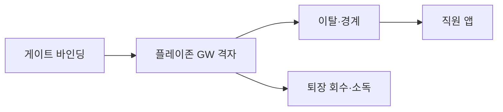
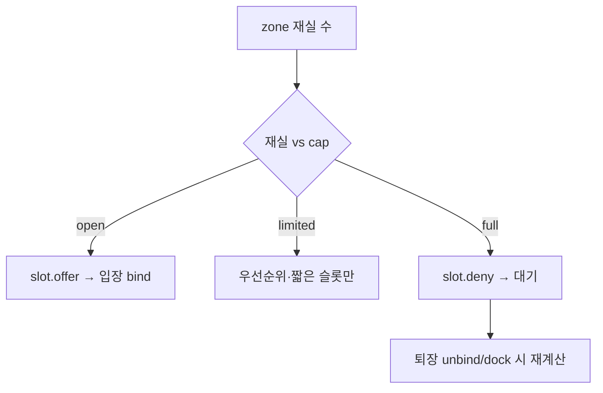

# PET-Aeye 넓은 공간 BLE 개체 추적 (초안 v0.4)

> 대상: 지상 플레이그라운드 · 옥상 루프탑 · 어질리티 · 광장 등 **넓은 공용 운동 공간**  
> 제품(Plan A): **Minew MWB01** + **MOKO MKGW1-BW** + **목줄 관통·몸쪽 밀착형** 실리콘 케이스  
> 연계: `PET-Aeye_횡성펫리조트_카메라_구성_초안.md` · `PET-Aeye_CCTV_서버_비용산정_초안.md` · 마스터 기획서  
> 단위: 만원 · VAT 별도 · **가정치**. 현장 실측 · 견적으로 확정합니다.  
> **v0.1**: 입장 태그 · GW 격자 · 비전/BLE 역할 분담.  
> **v0.2**: 목줄 관통·몸쪽 밀착 케이스(매달림형 금지).  
> **v0.3**: 구매 BOM · 프로비저닝 · Zone/KPI · MQTT 이벤트 · 옥외 함체/PoE · RF 서베이 · 운영 데스크 · 대안 벤더.  
> **v0.4**: **혼잡 슬롯** · **회수 도킹함** · **플레이 리캡 카드**(CareReport 연동).

---

## 0. 이 문서가 답하는 것

| # | 질문 | 답 위치 |
|---|------|---------|
| 1 | 무엇을 사야 하나 | §2 BOM · §2.1~2.4 구매 스펙 |
| 2 | 위치가 얼마나 정확한가 | §5 Zone · KPI (cm급 아님) |
| 3 | 앱·서버와 어떻게 붙나 | §6 MQTT · 이벤트 · 비전 조인 |
| 4 | 야외에 어떻게 달나 | §3 배치 · §3.5 함체/PoE |
| 5 | 직원이 하루 어떻게 돌리나 | §4 케이스 · §7 운영 · §7.2 데스크 |
| 6 | 벤더가 막히면 | §9 Plan B · Phase 2 |
| 7 | 혼잡·회수·보호자 가치 | §7.4~7.6 (v0.4) |

---

## 1. 왜 BLE 태그를 쓰는가

실내 객실·복도는 NPU 카메라 비전 추적만으로 충분합니다.  
**지상 플레이그라운드 · 옥상 루프탑**처럼 면적이 넓고 개체가 많고 · 원거리 · 부분 가림이 잦은 공간에서는 비전만으로 개체 ID를 유지하기 어렵습니다.

| 방식 | 역할 | 한계 |
|------|------|------|
| NPU / 실외 CCTV + 엣지 | 행동 · 포즈 · 이상행동 · 보안 녹화 | 넓은 야외에서 동일 개체 ID 유지가 어려움 |
| **BLE 태그 (본 문서)** | **입장~퇴장 동안 개체 ID · 구역 체류 · 이탈 감지** | RSSI 구역 수준(수 m~십수 m), **cm급·실내측위급 아님** |

**운영 원칙:** 플레이 공간 **입장 시** MWB01을 **목줄 관통형 실리콘 케이스**(몸쪽 밀착)에 넣어 착용 → **퇴장 시** 회수·소독.  
카메라는 행동, BLE는 “어느 개가 어느 구역에 있는지”.

---

## 2. 하드웨어 · 구매 BOM

### 2.0 구역당 BOM (플레이존 1곳 · 가정)

| SKU | 품목 | 권장 모델/스펙 | 수량 예 | 단가 가정 | 소계 |
|-----|------|----------------|---------|-----------|------|
| T-01 | BLE 태그 | Minew **MWB01** | 80 | 1.5 | 120 |
| C-01 | 실리콘 케이스 | AirTag 호환 **목줄 관통형** (매달림 금지) | 120 | 0.4 | 48 |
| G-01 | BLE 게이트웨이 | MOKO **MKGW1-BW** (Pro) | 5 | 18 | 90 |
| E-01 | 옥외 함체 | IP65+ · GW 수납 · 차양 · 케이블 그랜드 | 5 | 8 | 40 |
| E-02 | 폴·벽 브래킷 | 높이 2.5~4 m · 풍압 고려 | 5 | 5 | 25 |
| N-01 | PoE 인입·공사 | Cat6 · PoE(802.3af) · 접지 | 5지점 | 12 | 60 |
| N-02 | PoE 스위치 포트 | 기존 스위치 여유 또는 소형 PoE 스위치 | 1식 | 25 | 25 |
| O-01 | 체크인 데스크 키트 | §7.2 | 1 | 40 | 40 |
| O-02 | 공용 목줄 (띠폭 호환) | 15~25 mm · 소독 가능 | 40 | 1.2 | 48 |
| O-03 | **회수 도킹함** | NFC/슬롯 · 자동 unbind 트리거 · 소독 큐 (§7.5) | 1 | 80 | 80 |
| S-01 | 수집·바인딩·슬롯·리캡 SW | PET-Aeye (공통) | — | — | 앱 개발 |
| | **합계** | | | | **약 576** |

- 카메라·엣지 박스 CAPEX와 **별도**.  
- 영종 루프탑 1 + 횡성 플레이존 1 ≈ **약 0.12억** (가정치).  
- O-03은 P1: 1차 오픈은 수동 회수(O-01)만으로도 MVP 가능.

### 2.1 태그 — Minew MWB01 (구매·프로비저닝 스펙)

| 항목 | 기준 (발주·설정) |
|------|------------------|
| 형태 | Φ31 × 9.2 mm · ≈6.7 g · AirTag 폼팩터 |
| 통신 | BLE 5.0 · **iBeacon** (1차) · Eddystone 예비 |
| 방수 | IP67 |
| 배터리 | CR 교체형 · 목표 수명 **≥6개월**(현장 설정 기준) |
| 센서 | 가속도(절전) · NFC(체크인 스캔 옵션) |
| 설정 앱 | BeaconSET+ · 일괄 프로비저닝 |

**시설 공통 프로비저닝 (확정안 초안)**

| 파라미터 | 값 (가정) | 이유 |
|----------|-----------|------|
| Advertising interval | **300 ms** (피크 혼잡 시 200 ms 검토) | 배터리↔검출 지연 균형 |
| Tx power | **0 dBm** (개활지) · 펜스 밀집 시 +4 dBm 테스트 | 과다 Tx는 인접 존 혼선 |
| UUID | 시설 공통 1개 (영종/횡성 분리 가능) | 필터링 |
| Major | 사이트·존 코드 (예: 영종=1, 횡성A=2) | |
| Minor | 태그 일련 (1~N) · DB의 `ble_tag_id`와 1:1 | |
| MAC allowlist | GW·서버에 등록된 MAC만 위치 처리 | 외부 비콘 노이즈 차단 |

**배터리 SOP:** 분기 1회 샘플 전압/수명 점검 · 잔량 경고는 가속도 절전 끊김·스캔 공백으로 간접 감지 · 교체 후 Minor/MAC 이력 유지.

### 2.2 게이트웨이 — MOKO MKGW1-BW (구매·연동 스펙)

| 항목 | 기준 |
|------|------|
| 역할 | BLE 광고 스캔 → **MQTT(TLS)** 업로드 (HTTP 백업) |
| BLE | 5.0 · 스캔 개활지 최대 ≈120~150 m (실효는 §3) |
| 스캔 능력 | ≥200 adv/s (피크 80태그×다중 GW 여유) |
| 네트워크 | **Ethernet PoE(802.3af) 우선** · Wi-Fi는 백업 |
| 크기 | 120 × 120 × 22.5 mm |
| 보호 | **IP20** → 반드시 E-01 함체 |
| 전원 | PoE · 대안 DC 9–15V |
| 필터 | UUID/MAC allowlist · RSSI threshold (존별) |
| 오프라인 | USB 로컬 버퍼(가능 시) · 복구 후 재전송 |
| 관리 | 원격 MQTT 설정 · 펌웨어 OTA(벤더 지원 범위) |

**GW 논리 ID:** `gw_id = {site}-{zone}-{nn}` (예: `yj-rooftop-01`, `hs-play-03`).

### 2.3 실리콘 케이스 — 목줄 관통·몸쪽 밀착 (C-01)

§4 상세. 구매 키워드: `collar slide` / `loop through` / `for dog collar`. **키링·클립 매달림 SKU 구매 금지.**

| 호환 띠 폭 | 판정 |
|------------|------|
| 15 mm · 20 mm | 1차 표준 (샘플 필수) |
| 25 mm | 대형견 공용 목줄 — 루프 여유 확인 |
| 30 mm 이상 | 비호환 가능 → 별도 SKU 또는 공용 목줄로 통일 |

### 2.4 네트워크 · 전원 (N-01 · N-02)

| 항목 | 기준 |
|------|------|
| 케이블 | Cat6 이상 · 옥외 구간은 옥외용 또는 관로 |
| PoE | 802.3af · 포트당 예산 ≥7 W (GW+여유) |
| VLAN | **BLE-IoT VLAN** (카메라 VLAN과 분리 권장) |
| 방화벽 | MQTT 브로커(내부)만 허용 · 인터넷 직접 노출 금지 |
| DNS/NTP | 사이트 공통 · GW 시각 동기 |

### 2.5 PET-Aeye 역할 분담

```
[MWB01] --BLE adv--> [MKGW1-BW × N] --MQTT/TLS--> [PET-Aeye ble-ingest]
                                                      |
                         +----------------------------+------------------+
                         v                            v                  v
                   zone engine                 staff alerts          guardian summary
                         |
                         +---- stay_id / pet_id ----> [camera events · clips]
```

| 계층 | 담당 |
|------|------|
| 벤더 | 광고 · 스캔 · MQTT 포워딩 · 함체 내 동작 |
| PET-Aeye | 바인딩 · Zone 엔진 · KPI · 이탈 알림 · 비전 조인 · 자산(배터리·분실) |

---

## 3. 설치 · 배치

### 3.1 배치 원칙

| 원칙 | 내용 |
|------|------|
| 실효 반경 | **25~35 m** (스펙 최대의 1/3~1/2) · 원 겹침 |
| 높이 | 바닥 기준 **2.5~4 m** |
| 전원·통신 | PoE 유선 우선 |
| 게이트 | 입장구 **GW ≥1** (`zone_type=gate`) |
| 사각 | 철펜스·콘크리트 뒤 추가 GW |

**수량 가이드 (서베이 전 가정)**

| 공간 | 면적 가정 | GW | 비고 |
|------|-----------|-----|------|
| 지상 플레이그라운드 | 1,500~2,500 ㎡ | 4~6 | 모서리+변+게이트 |
| 옥상 루프탑 | 400~800 ㎡ | 3~4 | 함체·차양 필수 |
| 어질리티·산책 | 구역당 | 2~4 | 선형 ≈30 m 간격 |

### 3.2 지상 플레이그라운드


| 기호 | 의미 |
|------|------|
| GW1~GWn | MKGW1-BW + E-01 함체 |
| 원형 음영 | 실효 커버리지 |
| Entrance | 태그 지급·회수 · `gate` 존 |



### 3.3 옥상 루프탑


### 3.4 사이트 적용

| 사이트 | 공간 | 카메라 | BLE |
|--------|------|--------|-----|
| 영종 | 옥상 놀이·루프탑 | NPU/실외 CCTV | GW 3~4 + 태그 풀 |
| 횡성 | 플레이그라운드·어질리티·광장 | 실외 CCTV+엣지 | GW 4~6/구역 + 태그 풀 |

### 3.5 옥외 함체 · 폴 · PoE (E-01 · E-02 · N-01)

MKGW1-BW는 **실내용(IP20)**. 야외·루프탑은 아래를 **필수 BOM**으로 둔다.

| 항목 | 기준 |
|------|------|
| 함체 | **IP65 이상** · 내부 체적 GW+여유 케이블 · 잠금 |
| 케이블 | 방수 그랜드 · 하부 인입(우수 역류 방지) |
| 열 | 직사 차양 · 내부 −20~45 ℃ 유지(통기·차열) · 필요 시 소형 팬/히터는 횡성 동계 검토 |
| 설치 높이 | 2.5~4 m · 강아지·손님 손 닿지 않음 |
| 폴 | 풍압·진동 · 접지 |
| PoE | 스위치↔함체 Cat6 · 낙뢰 다발 지역은 서지 검토 |
| 라벨 | 함체 외부 `gw_id` · 내부 MAC 스티커 |

**설치 순서**

1. 도면 후보점 → §8 RF 서베이 → 대수·위치 확정  
2. 폴/브래킷 · 함체 · PoE 인입  
3. GW MQTT·필터·`gw_id` 등록  
4. 게이트 GW를 `zone_type=gate`로 분리  
5. 72시간 soak (누락·오프라인·온습도)

---

## 4. 목줄 장착 — 관통·몸쪽 밀착형 실리콘 케이스

### 4.1 형태 판정

| 형태 | 판정 | 이유 |
|------|------|------|
| **목줄 관통형** | **채택** | 몸쪽 밀착 · 물림·걸림 최소 |
| 키링·클립 매달림 | **금지** | 상대견 물어뜯김 · 분실 |
| 금속 케이스 | 비권장 | 신호 감쇠 |
| 발목만 | 비권장 | 벗겨짐 |


| 단계 | 작업 |
|------|------|
| 1 | MWB01 → 케이스 포켓 |
| 2 | 목줄 띠를 좌·우 루프 **관통** → 몸쪽 밀착 |
| 3 | 흔들림 확인 |
| 4 | 앱 바인딩 (`tag`↔`stay`/`pet`) 후 입장 |
| 5 | 퇴장 분리 · 소독 · 보관 |

공용 목줄에 케이스 선장착 + 태그만 교체 가능(소독 필수).

---

## 5. Zone 모델 · 측위 KPI

### 5.1 측위 등급 (기대치 고정)

| 등급 | 의미 | Phase |
|------|------|-------|
| **L1 Zone presence** | 어느 GW(존)에 있는가 | **MVP (본 문서)** |
| **L2 Gate transit** | 입장/퇴장 게이트 통과 시각 | MVP |
| L3 Multi-GW rough | 다중 RSSI로 존 내부 대략 위치 | 선택 (P1) |
| L4 cm / AoA / UWB | 정밀 측위 | **Phase 2 · 보류** (§9) |

보호자·운영 문구: “플레이존 **구역** 체류” — “몇 미터 좌표” 약속 금지.

### 5.2 Zone 타입

| zone_type | 설명 | 알림 |
|-----------|------|------|
| `gate` | 입장·퇴장 게이트 | 바인딩/언바인딩 트리거 |
| `play` | 본 플레이 격자 | 체류·혼잡도 |
| `buffer` | 경계 완충 | 이탈 예비 |
| `off_limit` | 금지·외곽 | **즉시 직원 알림** |

존 판정(초안): 최근 N초(예: 5s) 창에서 **최강 RSSI GW**가 속한 존 · 게이트는 별도 RSSI 임계+체류시간(예: ≥1.5s)으로 debounce.

### 5.3 KPI (오픈 전 목표 · 가정)

| KPI | 목표 | 측정 |
|-----|------|------|
| 게이트 통과 검출률 | ≥95% | 수동 입장 로그 대비 |
| 이탈(`off_limit`) 알림 지연 | ≤15 s (p95) | 이벤트 시각 − 실측 |
| 동시 활성 태그 | ≥80 / 구역 | soak |
| 외부 비콘 오인 | ≈0 (allowlist) | |
| GW 월간 가용성 | ≥99% | 하트비트 |
| 태그 분실률 | 운영 목표 &lt;2%/월 | 자산 |

---

## 6. 연동 — MQTT · 이벤트 · 비전 조인

### 6.1 토픽 (초안)

| 토픽 | 방향 | 내용 |
|------|------|------|
| `petaeye/{site}/ble/gw/{gw_id}/adv` | GW→서버 | 스캔 광고 배치 |
| `petaeye/{site}/ble/gw/{gw_id}/status` | GW→서버 | online · RSSI noise · uptime |
| `petaeye/{site}/ble/cmd/{gw_id}` | 서버→GW | 필터·threshold 원격 설정 |

TLS · 장비별 자격증명 · ACL은 사이트 공통 IoT 정책.

### 6.2 광고 페이로드 (논리 필드)

```json
{
  "gw_id": "hs-play-03",
  "ts": "2026-10-21T05:00:00Z",
  "mac": "AA:BB:CC:DD:EE:FF",
  "uuid": "...",
  "major": 2,
  "minor": 37,
  "rssi": -67,
  "battery": null
}
```

서버는 MAC/Minor → `ble_tag_id` → 활성 `stay_id`/`pet_id`로 resolve. 미바인딩 태그는 자산·분실 큐로.

### 6.3 도메인 이벤트 (앱·관제)

| 이벤트 | 의미 | 표면 |
|--------|------|------|
| `ble.tag.bind` | 입장 바인딩 | 스태프 |
| `ble.tag.unbind` | 퇴장·회수 (수동 또는 도킹) | 스태프 |
| `ble.zone.enter` / `exit` | 존 이동 | 관제 · 혼잡 집계 · (선택) 보호자 |
| `ble.geofence.breach` | `off_limit` | 스태프 우선 알림 |
| `ble.tag.missing` | N분 미검출 | 스태프 · 자산 |
| `ble.gw.offline` | GW 하트비트 끊김 | 관리자 |
| `ble.play.crowd` | 존 동시 마리 수·용량 대비 % | 스태프 · 관제 · (선택) 보호자 |
| `ble.play.slot.offer` / `deny` | 입장 가능/대기 판정 | 스태프 · 보호자 |
| `ble.dock.return` | 도킹함에 태그 안착 · unbind 후보 | 스태프 · 자산 |
| `ble.play.recap.ready` | Stay 단위 플레이 리캡 생성 완료 | CareReport · 보호자 |

### 6.4 카메라 이벤트와 조인

| 규칙 | 내용 |
|------|------|
| 키 | 동일 `stay_id` / `pet_id` |
| 플레이존 이상행동 | **비전 이벤트 우선** · BLE로 개체 확정 |
| ID 충돌 | BLE 바인딩 활성 태그를 우선 · 비전 track은 보조 |
| BLE만 이탈 | 행동 클립 없이 직원 순찰 알림 |
| GW 장애 | 해당 존은 카메라+인력 폴백 · 관제에 `ble.degraded` |

---

## 7. 운영

### 7.1 일일 플로우

| 시점 | 행위 | 시스템 |
|------|------|--------|
| 호텔 체크인 | 개체·Stay | PMS / PET-Aeye |
| 플레이 입장 | 케이스 장착 · bind · gate | 스태프 앱 |
| 플레이 중 | zone · 혼잡 · breach | 다중 GW |
| 이상행동 | 비전 + BLE ID | 조인 |
| 퇴장 | unbind · 소독 · 보관 | 스태프 앱 |
| 마감 | 미반납 태그 목록 · GW 상태 | 관리자 |

### 7.2 체크인 데스크 키트 (O-01)

| 품목 | 용도 |
|------|------|
| 태그·케이스 보관함 (칸막이) | 청결/오염 분리 |
| 소독 용품 · 장갑 · 건조대 | 회수 후 |
| NFC/QR 스캐너(옵션) | 바인딩 속도 |
| 예비 목줄·케이스·태그 | 피크·파손 |
| 공용 태블릿(스태프 앱) | bind/unbind |
| 폐기함 | 물어뜯긴 케이스 |

### 7.3 자산 · 장애

| 상황 | 조치 |
|------|------|
| 케이스 물림·찢김 | 폐기 · 태그 소독 · 재고 −1 |
| 태그 분실 | 즉시 `inactive` · Minor 재사용 금지(쿨다운) |
| GW offline | `ble.gw.offline` · 현장 점검 · 카메라 폴백 |
| 배터리 의심 | 교체 · 교체 로그 |

### 7.4 혼잡 슬롯 (Crowd Slot) — P0.5 / P1

Zone 실시간 재실 수를 용량과 비교해 **지금 입장 가능 / 대기**를 스태프·(선택) 보호자 앱에 표시합니다. 싸움·과밀·소음 민원을 줄이는 운영 기능입니다.

| 항목 | 기준 (가정) |
|------|-------------|
| 입력 | `play` 존 내 **바인딩 활성 태그 수** (L1 presence) |
| 용량 `cap` | 존별 설정 (예: 루프탑 12 · 지상 플레이 25) — 면적·스태프 수로 조정 |
| 상태 | `open` (재실 &lt; 0.85·cap) · `limited` (0.85~1.0) · `full` (≥ cap) · `cooldown` (사건 후 N분) |
| UX 스태프 | 입장 화면: 초록/노랑/빨강 · 대기 큐(선택) |
| UX 보호자 | “지금 입장 가능” 또는 “약 N분 대기 예상”(선택 노출 · 과장 금지) |
| 이벤트 | `ble.play.crowd` · `ble.play.slot.offer` / `deny` |
| 비전 연동 | 이상행동 다발 시 매니저가 `cap` 임시 하향 또는 `cooldown` |



**KPI:** full인데 강제 입장한 비율 · 대기 후 실제 입장 전환율 · 혼잡 시간대 이상행동 건수(전후 비교).

### 7.5 회수 도킹함 (Return Dock) — P1 · BOM O-03

게이트 옆 **NFC/슬롯 도킹함**: 태그를 꽂으면 자동으로 회수 후보를 만들고, 스태프 확인 또는 정책에 따라 `unbind`합니다. 미반납·분실을 줄입니다.

| 항목 | 기준 |
|------|------|
| 위치 | 입장 게이트와 같은 데스크 동선 · 비·직사 가림 |
| 인식 | **NFC(MWB01)** 1차 · 보조로 슬롯 근접 BLE / QR |
| 슬롯 수 | 피크의 30~50% (예: 동시 80 입장 → 슬롯 24~40) 또는 순환형 소형함 |
| 플로우 | 안착 → `ble.dock.return` → 앱 “회수 확인” → `unbind` → 소독 큐 칸으로 이동 |
| 실패 | NFC 미인식 시 수동 스캔 · 분실 태그는 `missing` 유지 |
| 하드웨어 | 시중 NFC 리더 + 칸막이함 또는 간이 키오스크 · PET-Aeye는 웹훅/시리얼 어댑터 |
| MVP 대체 | 도킹 없이 O-01 수동 회수 + 마감 미반납 목록 |


### 7.6 플레이 리캡 카드 (Play Recap) — P1 · CareReport

Stay 동안 BLE 체류 + (있으면) 비전 하이라이트를 묶어 **한 장의 플레이 요약**을 만듭니다. 보호자 가치·재방문 메시지에 씁니다.

| 필드 | 출처 | 예시 |
|------|------|------|
| 총 플레이 시간 | `play` 존 enter/exit 합 | “루프탑 23분” |
| 방문 존 | zone 이력 | “지상 플레이 · 어질리티” |
| 게이트 통과 | `gate` L2 | “입장 2회” |
| 혼잡 노출 | crowd 상태와 겹친 시간 | “혼잡 구간 5분”(내부·선택 노출) |
| 하이라이트 | 비전 클립 조인 | 썸네일 2~3 |
| 스태프 한 줄 | 수동/템플릿 | “오늘 사회화 양호” |

| 항목 | 기준 |
|------|------|
| 생성 시점 | 플레이존 **마지막 unbind/dock** 또는 당일 마감 배치 |
| 이벤트 | `ble.play.recap.ready` |
| 노출 | 일일 CareReport 카드 · Stay 졸업 리포트 섹션 |
| 톤 | 웰니스·관찰 · 의료·성격 단정 금지 |
| 개인정보 | 다른 개·사람 얼굴 나오는 클립은 기존 블러·검수 정책 |

---

## 8. RF 서베이 절차 (대수 확정)

서베이 없이 BOM 대수를 확정하지 않습니다.

| 단계 | 내용 |
|------|------|
| 1 | 도면에 후보 GW · 5 m 격자점 표시 |
| 2 | 설정 완료 태그 1개를 목줄 높이(≈0.3~0.5 m)로 격자 이동 |
| 3 | 각 점에서 GW별 RSSI 기록 (앱 또는 로그) |
| 4 | 실효 커버(예: RSSI ≥ −85 dBm) 히트맵 · 구멍에 GW 추가 |
| 5 | 게이트 임계·debounce 튜닝 (오검출/미검출) |
| 6 | 동시 20·50·80 태그 soak 30분 |
| 7 | 결과표 → 최종 GW 수 · 존 폴리곤 · KPI 베이스라인 |

**산출물:** RSSI 히트맵 · GW 좌표 · 존 정의 JSON · KPI 측정표.

---

## 9. 대안 · 로드맵

### 9.1 Plan A (기준) vs Plan B

| | Plan A (기준) | Plan B (락인 완화) |
|--|---------------|-------------------|
| 태그 | Minew MWB01 | 동일 폼팩터 iBeacon 호환품 (IP67·Φ31) |
| GW | MOKO MKGW1-BW + 함체 | Minew 계열 GW 또는 **IP65 일체형** 야외 GW |
| 장점 | 문서·단가·수급 검증 용이 | 함체 생략 가능 · 단일 벤더 지원 |
| 단점 | 함체·PoE 공사 필요 | 단가·연동 재검증 |
| 전환 조건 | — | A 수급 실패 · 함체 TCO가 B보다 클 때 |

소프트웨어(토픽·이벤트·존)는 Plan A/B 공통. GW 어댑터만 교체.

### 9.2 기능 로드맵 (제품)

| Phase | 기능 | 의존 |
|-------|------|------|
| **MVP** | bind/unbind · Zone L1 · Gate L2 · 이탈 · 수동 회수 | v0.3 장비 |
| **P0.5** | **혼잡 슬롯** (§7.4) 스태프 전용 | 재실 집계 안정 |
| **P1** | 혼잡 보호자 요약 · **회수 도킹** · **플레이 리캡** | O-03 · CareReport |
| **P2** | 대기 큐·프라이빗 슬롯 유료 · 존 히트맵 SaaS | 다점포 |

### 9.3 Phase 2 측위 (보류)

| 기술 | 언제 검토 |
|------|-----------|
| AoA / 방향 안테나 | L3로도 운영 KPI 미달 + 예산 확보 |
| UWB | cm급이 상품 약속이 될 때만 (비용·태그 폼팩터 재설계) |
| 비전 Re-ID만으로 야외 | 혼잡·원거리 검증 후에만 BLE 축소 |

---

## 10. 설계 · 구매 체크리스트

**구매**
- [ ] MWB01 견적(로트·배터리·BeaconSET+ 일괄) · UUID/Major/Minor 체계 확정
- [ ] MKGW1-BW · MQTT TLS · 필터 · PoE 확인
- [ ] IP65 함체·차양·그랜드·폴 SKU
- [ ] 목줄 관통 케이스 — 띠폭 15/20/25 mm 샘플 · 매달림형 제외
- [ ] 공용 목줄 · 데스크 키트

**현장**
- [ ] 도면 GW·PoE·VLAN
- [ ] §8 RF 서베이 · KPI 베이스라인
- [ ] 게이트/off_limit 존 폴리곤
- [ ] 72h soak

**소프트웨어**
- [ ] ble-ingest · 토픽 · ACL
- [ ] bind/unbind UI · 분실 비활성화
- [ ] 비전 조인 · `ble.degraded` 폴백
- [ ] 자산(배터리·케이스 폐기) 화면
- [ ] 혼잡 슬롯: 존별 `cap` · crowd 이벤트 · 스태프 UX (§7.4)
- [ ] 회수 도킹: NFC 어댑터 · `ble.dock.return` (§7.5) — 또는 MVP 수동 회수
- [ ] 플레이 리캡 → CareReport 카드 (§7.6)

---

## 11. 관련 문서

| 문서 | 반영 |
|------|------|
| `PET-Aeye_횡성펫리조트_카메라_구성_초안.md` | 실외 = CCTV + BLE |
| `PET-Aeye_CCTV_서버_비용산정_초안.md` | 옥상 = NPU/CCTV + BLE (CAPEX 별도) |
| 마스터 기획서 | 옥상·PlayZone · BLE 링크 |
| 앱 스펙 덱 §09 | 배치·케이스·체크인 |

---

*가정치 기반 초안입니다. RF 서베이 · 견적 · soak 후 BOM·KPI를 확정본으로 올립니다.*
