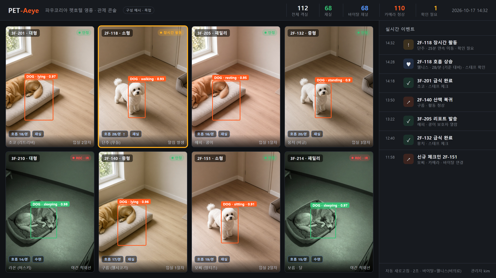
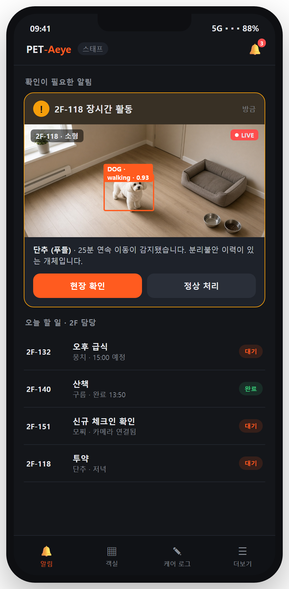
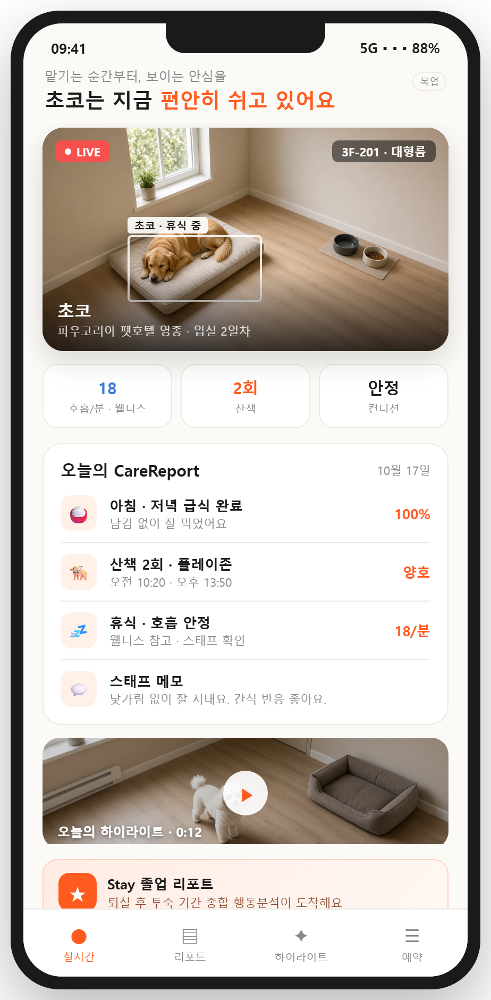
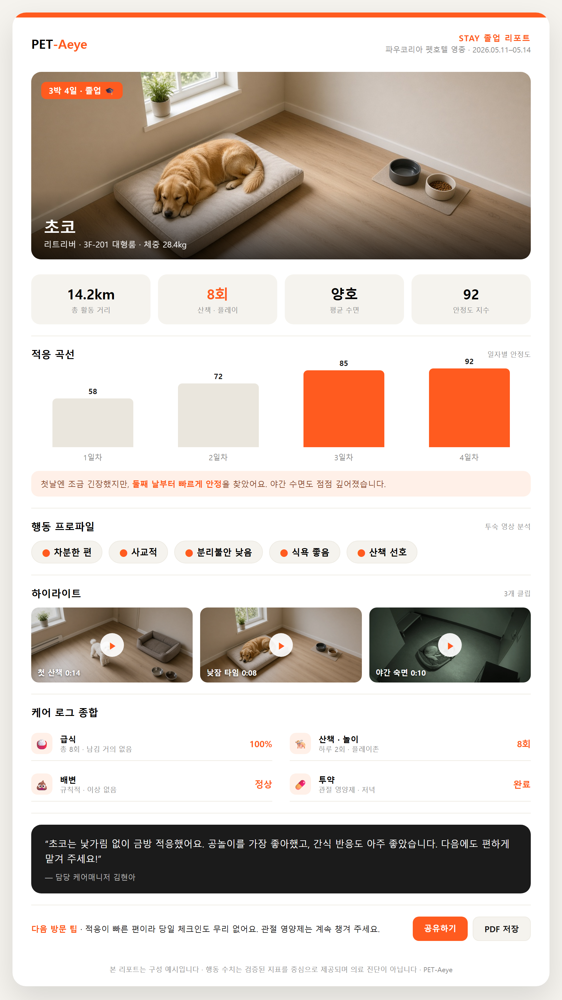

# 마스터 기획서 — 파우코리아 펫호텔 영종 × PET-Aeye

> 버전: **v1.3.1** · 2026-10-21 · 내부 논의용 (단일 소스) · [변경 이력](#변경-이력-changelog)  
> 덱: `PLAN_PAWKOREA_pet_hotel_PET-Aeye_master_v1.3.1.pptx` (`_build_master_pptx.py`, 65장) · 앱 스펙: `PLAN_PET-Aeye_apps_spec_v0.3.pptx`  
> 통합 범위: 기존 **기획서 · PET-Aeye 기능맵 · 라이다 바이탈 · IR** 을 하나로 합친 문서입니다.  
> 전체 사업 범위(펫장례 포함): `프로젝트_범위_확장_초안.md` (별도 유지)  
> 시설 근거: **인수 대상 실물 자산(영종 운남동 NPL 펫호텔)** · 참고: `펫호텔/펫텔 사업계획서_리조이스_final_250323_260704_124640.pdf`
> 인수 실사·밸류에이션: `NPL_펫호텔_인수실사_밸류에이션_초안.md` · PET-Aeye 설치: `PET-Aeye_리트로핏_설치계획_초안.md` · CCTV·서버 비용: `PET-Aeye_CCTV_서버_비용산정_초안.md` · 관제 SW 구성: `PET-Aeye_관제SW_시스템구성_제안.md` · 구독 요금: `PET-Aeye_구독요금_산정_초안.md` · 홈서비스: `PET-Aeye_홈서비스_기획_초안.md` · 센서 기술: FMCW 라이다 반도체(기반 기술 확보)  
> 넓은 공간(플레이그라운드·루프탑) BLE 개체 추적: `PET-Aeye_넓은공간_BLE개체추적_초안.md` (Minew MWB01 + MOKO MKGW1-BW)  
> 서비스 범위·IT 툴(별도): `PET-Aeye_서비스범위_IT툴_기획서_초안.md` · UI 목업: `doc/_mockups/`  
> 제품 코드: `peti-mvp` (제품명 PET-Aeye) · 통화: KRW

---

## 0. 개요

**목적:** **영종 운남동의 오픈 직전 NPL 프리미엄 펫호텔을 인수**하여, 파우코리아 브랜드로 개업·운영하고, 자체 AI 관제 PET-Aeye를 리트로핏하며, 라이다 비접촉 바이탈 확장·SaaS 사업까지 한 문서로 정리합니다.

**접근 전환:** 신축/임차(그린필드)가 아니라 **턴키 자산 인수**입니다. 가장 무거운 인테리어·설비 capex를 선투자자가 태운 상태라, *"잔여 마감 + 설비 복구 + PET-Aeye 리트로핏 + 운영 준비"* 만으로 **조기 개업**을 노립니다.

**범위:** 위탁형 펫호텔(인수 자산) · PET-Aeye 리트로핏 적용 · PET-Aeye SaaS · 라이다 바이탈(PoC).
**제외:** 동반숙박 · 장례 상세는 범위 밖(연계만). 인수 권리분석·밸류에이션은 별도 문서.

**전제:** 동물위탁관리업 등록 경험 보유 · 자산 인수 및 권리해소 완료 가정 · 잔여 마감/설비 복구 후 PET-Aeye 운영.

> ⚠️ **수치 주의:** 아래 정량 모델(객실수·ADR·수익)은 리조이스 사업계획서 기반의 **placeholder** 입니다. **인수 자산의 실측(객실수·연면적·가격)** 확보 시 전면 재계산하고 덱(`_build_master_pptx.py`)도 그 숫자로 재생성합니다.

### 0.1 대상 자산 (인수)

현장 사진 기준으로 파악된 시설(실사로 확정):

| 구분 | 내용 |
|------|------|
| 입지 | 인천 영종구 운남동로 44 · 영종하늘도시 생활권 · 공항 T1 차로 10분 |
| 건물 | 붉은 벽돌 3층 + 인접 **제2동**(인수 범위 TBD) · 대형 평면 주차장 |
| 객실 | 유리문 켄넬형 다수 + 박공 **프리미엄 스위트** + 복층 계단 **럭셔리 테마룸** |
| 부가시설 | **미용실**(미용대·드라이어) · **펫 스파**(자쿠지 욕조 다수) · 라운지 · **옥상 놀이방**(전망·놀이풀·리셉션) · 카페 · 로비 |
| 마감 | 테라조·대리석·헤링본 우드·간접조명 등 고사양(= 고 capex 선투자) |
| 상태 | 대부분 완성, 일부 구역 미시공/철거 중 |
| PET-Aeye 호재 | 전 객실 **유리문** + 천장 **돔 카메라 설치 추정** → 리트로핏 최적 |

> 기존 112실 모델은 **1동 4층 가정**이었으나, 실물은 **3층 + 제2동** 구조입니다. 객실수·층 구성은 실측으로 교체합니다.

### 0.2 입지 (요약)

운남동 약 2.9만 명/1.36만 가구(45개월 +39% 급성장), 반려가구 밀집·산책 인프라 양호, 공항 10분. 도보 상권은 약하나 **대형 주차장 + 픽업·발렛 모델**로 상쇄. 상세·리스크·폐업원인 가설은 `NPL_펫호텔_인수실사_밸류에이션_초안.md` 4.1 참조.

**구조:** 호텔 → PET-Aeye → SaaS는 하나의 흐름입니다. 호텔은 PET-Aeye의 첫 고객이자 쇼룸이고, PET-Aeye는 호텔의 차별점입니다.

| 층위 | 내용 | 역할 |
|------|------|------|
| 호텔 운영 | 112실 위탁 숙박 · 케어 · 스파 · 미용 · 샌딩 | 매출 · 현장 검증 |
| PET-Aeye | 보고 · 알리고 · 요약 (+ 라이다 바이탈) | 차별화 · 운영 효율 |
| SaaS | 위탁형 펫호텔 · 유치원 · 병원 · 훈련소 | 두 번째 매출원 |

---

## PART 1 · 왜 · 시장

### 1.1 제안 요지 (Thesis)

| 제안 이유 | 근거 |
|-----------|------|
| ① 영종에는 구조적인 위탁 수요가 있다 | 대형 리조트 약 2,545실(인스파이어·파라다이스시티) 반려 입실 제한 + 공항 10분 + 신도시 생활권 |
| ② 공식 공항 채널 밖에 중대형 수요가 남아 있다 | 공항 공식 호텔링 1개 업체 · 약 13kg 이하 중심 |
| ③ 객실이 아니라 '보이는 안심'으로 차별화한다 | PET-Aeye 실시간 캠 · AI 이벤트 · 일일 리포트 |

### 1.2 진입 기회 — 세 가지 숫자

- **0실** — 인스파이어 리조트의 반려동물 입실 가능 객실. 투숙객에게 인근 위탁이 필요합니다.
- **13kg** — 인천공항 공식 호텔링 수용 체중 기준(안내). 중·대형견 보호자는 다른 선택지를 찾습니다.
- **26실** — 저희 3층 대형 22실 + 패밀리 4실. 공식 채널이 받기 어려운 보호자를 맞이합니다.

### 1.3 수요 · 시장

- **공항 출국**: 출국 전 맡기고 귀국 시 찾는 수요. 공항공사가 호텔링 카운터를 직접 열 만큼 확인됨.
- **대형 리조트 투숙**: 반려 동반 투숙이 제한되는 인스파이어(1,275실)·파라다이스시티(1,270실, 2026 확장) 등 **영종 생활권 5성 리조트 약 2,545실**의 투숙객 단기 위탁. 외국인·장기·MICE 수요 포함. 연계는 컨시어지·FAQ 제휴, 객실+펫 위탁 번들, 직원·대관 송객 등 B2B 중심.
- **영종 생활권**: 하늘도시·미단시티 거주 가구의 출장·여행·데이케어 수요로 비수기 보완.
- 국내 펫 보딩 시장 약 980억 → 1,830억(2024→2030E, CAGR 11.1% 전망, Grand View Horizon · 동반숙박 제외).

### 1.4 포지셔닝

2×2(수용 범위 × 안심 투명성)에서 **'중대형 × 보이는 안심'** 사분면이 영종에서 비어 있습니다. 독독(공항 공식·소형 중심), 더우프앤(공항 샌딩·장기 할인), 앤드(중대형·생활권), 호텔독스(서울·AI 캠, 권역 외) 대비, 파우코리아는 중대형 수용 + AI 리포트형 안심을 함께 제공합니다. (공개 정보 기반 정성 배치)

### 1.5 원 사업계획서에서 가져온 사실

| 항목 | 내용 |
|------|------|
| 위치 | 인천 중구 운남동로 44 (영종 운남지구) |
| 교통 | 영종역 5분 · 금산IC 약 3km · 영종IC 약 3.5km · 인천공항 약 15분 |
| 주변 | 하늘도시 · 미단시티 · 인스파이어 약 2km |
| 규모·상태 | 1동 4층 약 370평(옥상 포함) · 1차 공사 완료, 오픈 예정 |
| 서비스 컨셉 | 24시간 CHECKING SYSTEM · 4 TYPE 객실 · SPECIAL PET FOOD |
| 2차(일정 미정) | B1F 펫 플레이파크 약 1,054평 · 나동 1F 동물병원 · 2F 펫몰 · 3F 파티룸 |
| 펫테크 근거 | KB금융지주 경영연구소: 펫테크 사용 이유 1위 '혼자 두고 외출 시 걱정 감소', 모니터링 CCTV·카메라 약 23% |

---

## PART 2 · 호텔에 담을 것

### 2.1 층별 공간

| 층 | 구성 |
|----|------|
| Roof | 루프탑 가든 (피크닉 존 · 야외 테라스 · 정원) |
| 3F | 대형 22실 · 패밀리 4실 (VIP 2타입) · 라운지 — 중대형 전용 층 |
| 2F | 소형 52실 · 중형 34실 · 라운지 · 펫 플레이존 |
| 1F | 프런트 · 상담/예약 · 펫 스파 · 미용실 · 휴식실 · 카페&베이커리 |

### 2.2 추가로 갖출 운영 공간 (위치 실측 후 확정)

관제실(PET-Aeye 룸 그리드 · 야간 관제) · 격리실 · 급식 준비실 · 세탁/소독실 · 비품·의약품 보관 · 이중문·출입 통제.

### 2.3 객실 상품

| 타입 | 위치 | 실수 | 대상 (가정) | 1박 요금 (가정) | 카메라 |
|------|------|------|-------------|-----------------|--------|
| 소형 | 2F | 52 | ~7kg | 5만 원 | 객실당 1대 (다실 1캠 검토) |
| 중형 | 2F | 34 | 7~15kg | 6.5만 원 | 객실당 1대 |
| 대형 | 3F | 22 | 15kg 이상 | 9만 원 | 객실당 1대 · 우선 적용 |
| 패밀리 | 3F | 4 | 다견 가족 · VIP | 15만 원 | 객실당 1~2대 |
| **합계** | | **112** | | **평균 약 6.6만 원** | 전 객실 PET-Aeye 연결 |

### 2.4 서비스 메뉴

| 구분 | 내용 |
|------|------|
| 기본 위탁 (모든 Stay) | 개체별 급식·급수, 하루 2회 이상 산책·놀이, 배변 처리·객실 청소, 24시간 상주 케어, 일일 케어 로그 |
| 부가 서비스 (선택) | 펫 스파·목욕, 미용, 공항 샌딩·픽업, 특식(SPECIAL PET FOOD), 투약 관리, 데이케어 |
| 안심 서비스 (PET-Aeye) | 배정 룸 라이브 열람, 일일 CareReport, 이상 시 보호자 알림(선택), 퇴실 하이라이트, Stay 졸업 리포트(종합 행동분석) |

**대표 패키지 '공항 안심 보딩'** = 숙박 + 공항 샌딩·픽업 + 안심 서비스.

### 2.5 운영 기준

| 구분 | 기준 |
|------|------|
| 입실 | 예방접종 증명 · 건강 문진(기저질환·복용약) · 공격성/분리불안 체크 · 생리/발정 여부 |
| 케어 | 개체별 식단·급여 시간 · 산책/놀이 일정 · 순찰과 PET-Aeye 관제 병행 · 케어 로그 → 리포트 |
| 인력 | 24시간 상주 · 위탁 20마리당 1명 이상 · 가동률 연동 근무표 · 야간 관제 담당 |
| 정책·동의 | 이용 약관 · 취소/환불 · 응급 진료 동의 · 영상 촬영/열람/보존 고지 · 배상책임보험 |

가동률 60%(하루 약 67마리)면 상시 최소 4명 필요.

### 2.6 오픈 준비 (워크스트림 · 일정)

| 영역 | 할 일 | 시작 |
|------|-------|------|
| 시설·인프라 | 112실·복도 카메라, 네트워크·녹화 스토리지, 관제실 | D-60 |
| 인력·교육 | 채용, PET-Aeye·응급 대응 교육 | D-60 |
| 운영 매뉴얼 | 체크인/아웃·케어·응급·이벤트 SOP | D-45 |
| 상품·가격 | 객실 요금표, 안심 요금 방식, 공항 패키지 | D-45 |
| 정책·법무 | 약관, 동의서, 영상 개인정보 고지, 보험 | D-45 |
| 예약·결제 | 예약 채널, 예약→Stay 연동 | D-30 |
| PET-Aeye 세팅 | 룸·카메라 매핑, 알림 규칙, 리포트 템플릿, 리허설 | D-21 |
| 마케팅·제휴 | 사전 마케팅, 여행사·카드사·숙박 앱·호텔 제휴 | D-30 |

일정: D-60 착수 → D-45 기준 확정 → D-30 예약 오픈 → D-14 리허설 → **D-0 그랜드 오픈** → D+30 첫 리뷰 → D+90 정착.  
**오픈 조건:** 전 객실 카메라 연결 · SOP 교육 완료 · 예약→Stay 연동 확인.

### 2.7 별관 — 생활권 확장 (펫유치원 · 펫 미용 · 펫용품)

2개동 캠퍼스 구성. **본관 = 머무는 안심(야간·숙박)**, **별관 = 매일 오는 이유(주간·통원·생활권)**. 두 엔진은 고객·브랜드·PET-Aeye를 공유하며, 별관의 주간·반복 수요로 본관 비수기를 메우고 LTV를 키웁니다.

**세 축 + 부가**

| 사업 | 핵심 수익원 | 성격 |
|------|-------------|------|
| 펫유치원 | 정기권 · 일일권 · 픽업 · 행동교정 클래스 | 주간 · 반복 |
| 펫 미용 · 스파 | 기본·전체 미용 · 스파 · 셀프워시 · 월 구독 | 고마진 · 고빈도 |
| 펫용품 리테일 | 매대 · 구독(정기배송) · 온라인 · 번들 | 고마진 · 반복 |
| 부가 | 아카데미 · 펫 카페 · 커뮤니티 · 이벤트 | 집객 · 멤버십 |

- **펫유치원**: 주간 데이케어·사회화. PET-Aeye 등원 라이브 + 일일/월 성장·사회성 리포트(졸업 리포트 응용). 통원 신뢰 → 호텔 전환 퍼널.
- **펫 미용·스파**: 생활권 워크인 미용(본관은 투숙객 부가 그루밍). 전/후 사진·리포트 전송, 유치원·호텔 번들. **그루밍 살롱·스파 설비 기보유 → 추가 capex 최소.**
- **펫용품 리테일**: 호텔·유치원 고객 기반 고마진 부가매출. 체험형 쇼룸 → 전환, 구독·번들로 반복 매출, 재고는 큐레이션·구독으로 최소.

**시너지**: 시간대 상보(야간 숙박 × 주간 통원) · 수요 상보(여행 × 생활권) · 교차 인력 · 공용(픽업 차량·관제실·백오피스·PET-Aeye) · 두 업태가 PET-Aeye SaaS 쇼룸.

**단계**: Phase 1 본관 호텔 오픈 + 별관 리테일 소규모 선오픈 → Phase 2 별관 유치원·미용 본격 가동·멤버십 통합 → Phase 3 아카데미·커뮤니티·PET-Aeye SaaS 확장.

### 2.8 캠퍼스 자산 활용 (지하주차 100대 · 잔디밭 · 1층 카페)

세 자산을 묶으면 **"신도시 주말 목적지 → 전 사업 전환 퍼널"** 의 집객 엔진이 됩니다. 차량 의존 상권에서 **주차 100대**는 "사람을 모을 수 있다"는 뜻이라 이벤트·대관·공항 번들을 가능케 하는 핵심 레버입니다.

**A. 가든 카페 + 오프리쉬 독파크 (집객 플라이휠)**
- 잔디밭 = 유료 독파크·어질리티(입장권·멤버십), 1층 카페 = 허브(잔디뷰 테라스·수제간식·생일 케이크).
- 반려가구 + 일반 신도시 주민까지 유입 → 미용·유치원·리테일·호텔로 전환 → PET-Aeye 안심 → 재방문.
- *주의: 견종 규칙·배상책임보험·안전요원 운영 전제.*

**B. 공항 원스톱 — 주차 + 보딩 + 샌딩**
- 공항 10분 + **지하 장기주차 100대**(+전기차 충전)를 묶어, 출국객에게 *차 맡기고·반려 맡기고·공항 샌딩* 원스톱.
- 공항 공식 채널이 못 주는 중대형 + 원스톱 편의 → 본관 가동률의 안정적 기반, 귀국 동선에서 미용·리테일 연결.

**C. 이벤트 · 대관 (잔디밭 + 주차 100대)**
- 소규모 행사(돌·생일·입양식·반려 웨딩) · 페스티벌·플리마켓·팝업(부스 임대+F&B) · 브랜드 촬영·장소 대여(협찬) · 운동회·도그 요가·멤버십 모임.
- 수익: 대관료 + 부스 임대 + F&B + 협찬. 집객이 전 사업 노출·미디어·제휴로 확산.

> (후보) D. 시즌 아웃도어(수영장·물놀이) · E. 지하공간 활용(실내 독런·팝업, 용도변경·소방 법규 전제)는 수요·법규 확인 후 검토.

### 2.9 별관 앵커 — 동물병원 (위탁 입점 · 제휴)

별관에 **동물병원을 앵커 테넌트로 유치**합니다. 의료는 목적성·반복 방문이라 미용·유치원·호텔·리테일로의 전환 퍼널이 되고, PET-Aeye·라이다 바이탈과 응급·건강관리로 연결되어 "의료가 있는 호텔" 신뢰를 만듭니다.

**입지 근거**: 운남동은 동물병원이 사실상 1곳뿐으로 의료 공백이 있고, 24시 응급·정밀검진은 중산동에 편중되어 있습니다. 영종구 반려동물 등록은 **14,347마리** 규모로 수요 기반이 충분합니다.

**구조(적법)**: 동물병원의 **개설·운영 주체는 수의사**여야 합니다(수의사법). 비수의사(법인)의 실질 운영은 이른바 **사무장병원**으로 금지되므로, 파우코리아는 **공간·집객·브랜드를 제공하는 임대인·제휴자**로 참여합니다.
- 수익 구조: **매출연동 임대료 + 제휴 수수료(RS)** — 의료수익 자체의 배분이 아니라 공간·송객 대가 형태. 병원 설비 capex는 수의사(입점사) 부담.

**시너지**: 호텔·유치원 입실 전 검진·예방접종 원스톱 / 투숙 중 이상 징후 → 원내 즉시 진료 / 공용 PET-Aeye·관제·픽업.

**리스크·유의**: 사무장병원 규제 → 임대·제휴 구조 + 법률 검토 필수 / 좋은 수의사 유치가 성패 / 주간 일반·예방·검진부터 시작, 24시 응급은 단계적.

---

## PART 3 · PET-Aeye (제품)

### 3.1 개요 — 보고 · 알리고 · 요약

- **보고**: 룸별 카메라 라이브 · 검출 오버레이
- **알리고**: 장시간 무움직임 · 이상 행동 → 스태프 우선 알림
- **요약**: Stay 단위 일일 리포트 · 보호자 기간 한정 링크
- **스태프 관제**: 112실 룸 그리드 · 이벤트 타임라인 · AI 검출/추적/행동 라벨 · PTZ 자동 추적 · 녹화
- **보호자 안심**: 기간 한정 링크로 배정 룸 라이브 · 일일 CareReport · 퇴실 하이라이트
- **구성**: RTSP 수신·녹화 · YOLO + ByteTrack · 이벤트 DB · 실시간 WebSocket · 관리자 웹 · 보호자 웹

### 3.2 화면 (구성 예시 · 목업)

**관리자 관제 화면** — 전 객실 라이브를 한 화면에서, 개체·행동·신뢰도 실시간 표시, 이상 객실 강조, 실시간 이벤트 로그.



**스태프 앱 · 보호자 앱**

| 스태프 앱 | 보호자 앱 |
|-----------|-----------|
|  |  |

> 위 화면은 구성 예시(목업)입니다.

### 3.3 고객 여정 × PET-Aeye

| 단계 | 호텔 업무 | PET-Aeye |
|------|-----------|----------|
| 예약 | 룸 타입·기간·옵션 접수 | Stay 사전 생성 |
| 체크인 | 건강 문진·동의서 | 룸·카메라 배정, 보호자 링크 발송 |
| 투숙 중 | 급식·산책·청소·순찰 | 룸 그리드 관제, 이상 행동 알림 |
| 매일 저녁 | 케어 메모 | CareReport 자동 생성·발송 |
| 체크아웃 | 인계·결제 | 링크 만료, 하이라이트 클립 |
| 이후 | 재방문 안내 | Stay 졸업 리포트 발송 · 이력·성향 기록 |

### 3.4 카메라 배치 기준

| 구역 | 층 | 수량 기준 | 목적 | 보호자 노출 |
|------|----|-----------|------|-------------|
| 소형·중형 객실 | 2F | 86실 · 객실당 1대 | 위탁 본체 관제 | 배정 룸 라이브 |
| 대형·패밀리 객실 | 3F | 26실 · 객실당 1대+ | 중대형 관제·우선 설치 | 배정 룸 라이브 |
| 라운지·플레이존 | 2–3F | 구역당 1대 (PTZ) | 놀이 관찰 | 하이라이트 |
| **옥상 놀이방·루프탑** | 옥상 | 카메라 + **BLE 태그** | 넓은 공간 개체 ID·구역 | 위치 요약·하이라이트 |
| 복도·이중문 | 2–3F | 출입구별 1대 | 탈출 방지·보안 | 비노출 |
| 프런트·스파·미용 | 1F | 구역당 1대 | 체크인·서비스 기록 | 선택 노출 |

인프라: PoE 스위치 · 녹화 스토리지 · 관제실 모니터 · 이중화 회선 · UPS. 최종 수량은 실측·화각 테스트 후 확정.  
**넓은 야외·루프탑:** 입장 시 Minew **MWB01**을 **목줄 관통·몸쪽 밀착형** 실리콘 케이스에 넣어 착용하고(상대견 물어뜯김 완화 · 매달림형 금지), MOKO **MKGW1-BW**로 추적합니다. 상세: `PET-Aeye_넓은공간_BLE개체추적_초안.md`.

### 3.5 이벤트 → 운영 액션

| PET-Aeye 신호 | 스태프 액션 | 보호자 노출 |
|---------------|-------------|-------------|
| 장시간 무움직임 | 현장 확인·필요 시 병원 | 리포트·선택 시 알림 |
| 과도한 반복 이동 | 산책·놀이 추가·성향 기록 | 일일 리포트 |
| 비인가 인원 검출 | 보안 점검·출입 기록 | 비노출 |
| 카메라 연결 끊김 | 즉시 점검·대체 순찰 | 비노출 |
| Stay 종료 | 링크 만료·보존 정책 | 하이라이트 제공 |

알림은 정확도가 확인된 규칙부터. 보호자에게는 스태프가 확인한 내용만 공유.

### 3.6 데이터 — Stay 하나로 연결

```
Guardian · Pet → Stay → Room → Camera
                         └→ PlayZone → BLE Tag (MWB01) + Gateway (MKGW1-BW)
Camera → PetEvent → CareReport → Guardian Link
```

체크인 때 스태프가 반려견과 카메라 트랙을 연결합니다. 플레이존·루프탑 입장 시에는 MWB01 태그를 목줄에 걸고 같은 Stay에 바인딩합니다. 연동 작업: 예약→Stay 자동 생성, 케어 체크리스트, Zone 규칙, 열람 감사 로그, 결제→옵션.

### 3.7 Stay 졸업 리포트 — 투숙 영상으로 만든 종합 행동분석

퇴실 시, 투숙 전 기간의 영상·이벤트를 모아 **한 장의 종합 리포트**를 자동 생성해 보호자에게 보냅니다. 일일 CareReport와 퇴실 하이라이트 클립을 **Stay 단위로 묶어 올린** 형태입니다.



**담기는 것**

| 영역 | 내용 |
|------|------|
| 활동 · 수면 요약 | 기간 활동량, 수면 패턴, 가장 활발했던 시간대 |
| 적응 곡선 | 첫날 대비 안정도 변화("차차 편해졌어요") |
| 행동 프로파일 | 성향(활발/차분), 분리불안 신호 유무 |
| 하이라이트 | 특이 이벤트 타임라인 + 클립 묶음 |
| 케어 로그 종합 | 급식·산책·배변·투약 + 스태프 코멘트·다음 방문 팁 |
| (라이다 이후) | 호흡·수면 안정도 추이 (PART 4) |

**왜 보내나**

- **한계비용 ≈ 0** — 투숙 영상·PetEvent는 이미 Stay에 쌓입니다. 체크아웃 트리거로 자동 생성만 붙입니다.
- **재방문 · 추천 엔진** — 공유하고 싶은 결과물이라 자연 바이럴. 공식 공항 채널엔 없는 차별점.
- **수익화 · 데이터 자산** — 기본 요약은 무료(마케팅), 풀 리포트는 안심 패키지 포함/프리미엄. 성향 베이스라인이 쌓여 재방문 시 개선을 추적합니다.

**주의** — 지금 행동 라벨은 휴리스틱 단계이므로 **검증된 지표만 숫자로**, 나머지는 정성 서술합니다. 의료·심리 단정 금지("웰니스·관찰" 톤). 리포트용 클립 생성 후 원본 영상 보존·동의 정책을 명확히 하고, **반드시 자동화**합니다(수작업 시 인건비 부담). 로드맵상 **일일 CareReport(P1)의 연장 → Stay 종합 리포트는 P1 후반~P2**.

---

## PART 4 · 라이다 바이탈 확장 (FMCW 라이다 · PoC)

### 4.1 왜 라이다인가

카메라(보는 것)에 FMCW 라이다(느끼는 것)를 더합니다. 라이다는 **빛이 없어도 호흡·재실 확인**, **μm급 변위로 미세 움직임 포착**, **영상이 아닌 거리·속도 데이터**(프라이버시)라는 점에서 카메라의 빈틈을 채웁니다.

### 4.2 FMCW 라이다 반도체 기술

| 항목 | 내용 |
|------|------|
| 방식 | WD-FMCW 4세대 — 거리·속도·재질 동시(6D) |
| 정밀도 | μm급, 1,000만 포인트급 |
| 형태 | 광반도체 + 신호처리 SoC + 솔리드스테이트 스캐너(KTN+메타렌즈), 기계 구동부 0 |
| 융합 | LiDAR + Camera Fusion · 멀티모달 AI SoC 내장 |
| 비접촉 바이탈 | 흉곽 μm 변위·도플러 → 호흡·미동·재실 |

> 기반 기술은 이미 확보되어 있습니다. CCTV에 결합하는 **융합 폼팩터만 설계**하면 되며, 바이탈은 '지금 운영 기능'이 아니라 **저희 일정에 맞춘 PoC·로드맵**으로 단계 검증합니다.

### 4.3 비접촉 측정 항목

| 항목 | 방식 | 도입 · 신뢰도 |
|------|------|---------------|
| 호흡수·호흡 패턴 | 흉곽 미세 변위(μm) | 1차 · 높음 |
| 미동·활동량 | 순간 속도(도플러) | 1차 · 높음 |
| 재실·자세·낙상 | 3D 포인트 위치·높이 | 1차 · 높음 |
| 수면·휴식 깊이 | 호흡·미동 규칙성 | 2차 · 중간 |
| 체형·대략 체중 | 3D 스캔 부피 | 2차 · 중간(보정) |
| 심박 추정 | 미세 진동 성분 분리 | 검증 후 · 조건부 |

의료 진단이 아니라 **웰니스·안심 지표**로 포지셔닝. 이상 소견은 수의 상담 권유로 연결.

### 4.4 폼팩터 · 리포트

**CCTV + FMCW 라이다 + 엣지 AI 퓨전** 융합 센서(1실 1센서). 기존 PET-Aeye 네트워크에 바이탈 채널만 추가. 우선 적용은 3F 중대형·패밀리 26실, 격리실·노령견 객실.

보호자 CareReport에 **호흡수 추이 · 수면 안정도(정량) · 호흡 급변/무미동/낙상 조기 알림 · 상태 한 줄 요약**을 추가.

### 4.5 호텔 확장성 (분석)

시니어·메디컬 케어 객실 · 야간·사각 보완 · 낙상·발작 조기경보 · 객실 환경 최적화 · 입·퇴실 3D 체형/체중 기록 · 분리불안 정량화 · 나동 동물병원 입원실 연계. SaaS **Vital 티어** 신설 + 정상 바이탈 베이스라인 **데이터 자산화**(펫보험·병원 제휴 근거).

### 4.6 로드맵 · 유의

P0 PoC 설계(센서 사양 확정) → P1 단일 객실 실증(반려견 대상) → P2 융합 폼팩터 → P3 상품화. 기반 기술은 확보되어 있어 **외부 반도체 일정에 얽매이지 않고 저희 일정으로** 진행합니다. **지금 운영 기능이 아니라 PoC·로드맵**. 반려견은 털·체격·품종 편차가 커 검증 필요, 심박은 조건부, 의료기기 아님.

---

## PART 5 · 비즈니스 & 확장

### 5.1 수익모델 — 순서대로 켠다

| 엔진 | 내용 | KPI |
|------|------|-----|
| NOW | 위탁 숙박 + 1층 부가 (4타입·체중별 요금·스파·미용·카페·샌딩) | 가동률 |
| NEXT | PET-Aeye 안심 옵션 (실시간 열람 + AI 리포트, 1박당 부가·VIP 포함) | 옵션 선택률·재이용 |
| LATER | PET-Aeye SaaS · 2차 (타 펫호텔·유치원 구독, B1F·나동) | 외부 고객·확장 판단 |

### 5.2 단위경제 — 부문별 연매출 (실사 전 가정 · 매출 기준 · 비용 미반영)

본관 호텔은 숙박+부가(15%)에 가동률 30·45·60%를 적용, 별관·캠퍼스는 부문 가정치. **펫 미용은 위탁 운영 — 총매출의 30%(파우코리아)만 반영**(위탁사 70%). **동물병원은 위탁 입점 — 매출연동 임대 + 제휴 수수료(RS)만 반영**(의료수익 배분 아님).

| 사업 부문 | 보수 | 기준 | 공격 |
|-----------|------|------|------|
| 본관 호텔 (숙박+부가) | 9.3 | 14.0 | 18.6 |
| 펫유치원 | 1.2 | 2.0 | 3.0 |
| 펫 미용 (위탁 RS 30%) | 0.4 | 0.6 | 1.0 |
| 동물병원 (위탁 입점 · 임대+제휴) | 0.6 | 1.2 | 2.0 |
| 펫용품 리테일 | 1.2 | 1.8 | 2.8 |
| 가든카페 · 독파크 | 1.3 | 2.0 | 3.0 |
| 이벤트 · 대관 | 0.4 | 0.8 | 1.5 |
| 공항 원스톱 주차 | 0.5 | 1.0 | 1.8 |
| 하드웨어 구독 · B2B 납품 | 0.3 | 0.8 | 2.0 |
| **합계 (억 원)** | **15.2** | **24.2** | **35.7** |

- 펫 미용 총매출 가정 1.4 / 2.1 / 3.3억 → ×30% = 0.4 / 0.6 / 1.0억(파우코리아 귀속).
- 동물병원은 임대료 + 제휴 수수료만 반영(병원 설비 capex·의료수익은 입점 수의사). 하드웨어는 바이탈 CCTV 구독+B2B 납품(양산 후 본격화) 가정. 리테일은 매출 기준이라 마진은 별도. 본관 가동률 10%p마다 숙박 연매출 약 3.1억 변동.
- 가정치는 실사·요금 설계로 갱신(`_build_master_pptx.py`의 `EXTRA_LINES`·`GROOM_GROSS`·`RS_GROOM`에서 조정).

### 5.3 인력 규모 · 고정비 (안정기 기준 · 실사 전 가정)

**인력 규모 (FTE, 파우코리아 직고용)**

| 부문 | 개업 | 안정기 |
|------|------|--------|
| 본관 호텔 케어 (24h) | 6 | 9 |
| 관제 · 프런트 | 2 | 3 |
| 펫유치원 | 2 | 3 |
| 훈련사 (행동) | 위탁 | 1 |
| 리테일 · 카페 | 2 | 3 |
| 픽업 · 시설 | 1 | 2 |
| 경영 · 지원 | 2 | 3 |
| **합계 (명)** | **15** | **24** |

- 24h 케어는 3교대 상주 기준. **펫 미용 = 위탁사 인력 / 동물병원 = 입점 수의사**는 직고용에서 제외.
- **훈련사(행동 전문가)**: 개업은 위탁·프리랜서 클래스로 수요를 검증하고, 안정기에 정규 1명(유치원 겸직)으로 전환. 유치원 행동교정 클래스·보딩 트레이닝·기질 평가(입소 사고 예방)·졸업 리포트 행동 해석을 담당. 반려동물행동지도사 등 유자격 권장.

**월 고정 · 준고정비 (안정기)**

| 항목 | 월 (만원) |
|------|-----------|
| 인건비 (4대보험 포함) | 8,450 |
| 수도광열 (24h 냉난방·환기) | 1,200 |
| 자산 금융비 (인수 조달) | 2,000 |
| 사료 · 소모품 · 위생 | 600 |
| 보험 · 세금 · 공과 | 400 |
| 마케팅 | 700 |
| 유지보수 · 보안 · IT | 800 |
| **합계 (월)** | **14,150** |

- **연환산 약 17.0억 원.** 자산 금융비는 인수가·조달(LTV·금리) 가정치로, NPL 매입 조건 확정 시 갱신합니다.
- 리테일 매입원가·결제수수료 등 변동비와 위탁 정산(미용 70%)은 별도. 기준 매출 약 23.4억(§5.2)과 대비해 가늠할 수 있으나, 완전한 손익계산서는 실사 후 작성합니다.

### 5.4 SaaS — 타깃 · 패키지 · 요건

**타깃:** 위탁형 펫호텔(핵심·Plus) · 유치원/데이케어(Plus) · 동물병원 입원실(Basic→Plus) · 위탁 훈련소(Plus). 첫 판매는 운영 방식이 같은 위탁형 펫호텔.

| 패키지 | 대상 | 포함 |
|--------|------|------|
| Basic — 스태프 관제 | 관제만 | 카메라·룸 매핑, 룸 그리드, AI 검출·이벤트, 녹화, 스태프 알림 |
| Plus — 보호자 안심 | 펫호텔·유치원 | Basic + Stay 관리, 기간 한정 링크, CareReport·하이라이트, Stay 졸업 리포트, 시설 로고 |
| Pro — 다지점·연동 | 체인 | Plus + 다지점 통합 관제, 예약 API·웹훅, 권한·감사 로그, 전담 온보딩 |
| **Vital (상위)** | 프리미엄 | 라이다 융합 센서 + 바이탈 리포트 번들 (PART 4, PoC 이후) |

**과금(안):** 카메라 1대당 월 구독(VAT 별도) — Basic 15,000원 · **Plus 25,000원** · Pro 30,000원 · Vital 45,000원(잠정). 객실 카메라는 Plus, 공용 카메라는 Basic으로 혼합 과금. 설치·온보딩 1회 150만원 + 대당 3만원. 근거: `PET-Aeye_구독요금_산정_초안.md`.  
**제품 요건:** 멀티테넌트·권한 · 온보딩(ONVIF·매핑 마법사) · 배포(클라우드/엣지) · 과금 계측 · 보안·개인정보 · 운영 지원.

### 5.5 SaaS 로드맵 · 영업

S0 영종 내부(오픈~6개월) → S1 파일럿(외부 2~3곳·멀티테넌트) → S2 정식 판매(요금제·설치 파트너) → S3 채널 확장. S0에는 호텔 운영 우선, SaaS 전용 기능은 S1부터.  
영업: 직접 영업(영종 견학·데모) · 설치 파트너(CCTV 시공사) · 업계 행사 · 연동 제휴. 가장 강한 도구는 영종 현장(동의받은 화면만 사용).

### 5.6 하드웨어 제품화 · B2B 납품 (바이탈 CCTV)

비접촉 바이탈(FMCW 레이더)을 **CCTV 폼팩터에 내장한 하드웨어 제품**으로 만들어, 리테일 자체 판매로 검증한 뒤 통신사에 B2B 납품합니다.

**차별화**: LG U+ 맘카/슈퍼맘카 등 기존 반려 CCTV는 사람·펫·소리 감지와 추적까지만 제공하고 **바이탈(호흡·미동)이 없습니다.** 통신사는 이미 *설치무료 · 구독 · 약정 · 손실보상금* 모델로 판매 중이라, 동일 모델에 **바이탈 상위 티어**로 얹을 수 있습니다.

| 구분 | 기존 반려 CCTV | PET-Aeye 바이탈 CCTV |
|------|----------------|----------------------|
| 기능 | 사람·펫·소리 감지·추적 | + 비접촉 바이탈(호흡·미동·재실) |
| 센서 | 카메라 | 카메라 + FMCW 레이더(내장) |
| 모델 | 설치무료·구독·약정(검증됨) | 동일 모델 + 프리미엄 상위 티어 |

**제품화 3단계**
1. **리테일 데모 · DTC 구독** — 별관 샵에서 실연 → 설치무료·구독·약정 자체 판매. 레퍼런스·바이탈 성능 데이터·후기 확보.
2. **양산 · 인증** — EMS 양산 파트너 · KC/전파 인증 · 영상 보안(통신사 요구 수준) · 소규모 양산.
3. **B2B 납품** — 통신사(LG U+ 등) 화이트라벨·ODM 또는 AI SW 레이어 공급. 동물병원·펫샵 체인 병행.

**역할 분담**: 견주 모니터링 앱 = 자체 개발 / AI·바이탈 추론 = PET-Aeye / 양산 = EMS 파트너.

**리스크·유의**: ⚠️ '바이탈'은 **웰니스·호흡·활동 모니터링(비의료)** 으로 표기 — 진단·의료 표현은 의료기기법 이슈. 가정 영상 **보안**(통신사 조달 수준)·FMCW 성능 **PoC** 선행. 통신사 벤더 등록·양산 품질·단가·독점 조건 주의. 연매출은 양산 이후 본격화(§5.2).

**홈서비스 · NPU 카메라 원가**: 가정용은 AI를 카메라 내장 NPU로 처리 — 대당 원가 기본형 약 4~4.5만원 · 표준형 약 7~7.7만원 · 바이탈형 약 10.5~14만원(가정치), 요금(안) 기본 월 6,900원 · **헬스 월 12,900원(주력)** · 바이탈 월 19,900원(36개월 약정 시 기기 무료). 시판 카메라 + 클라우드 AI 파일럿 → ODM 표준형 → 자체 설계 바이탈형 순. 경쟁(2026.10): 통신사 입문형 홈캠 월 5,500원(LG유플러스 홈캠 Lite) · 국내 AI 행동 펫캠 킨포라 · 아기용 카메라 + 레이더(Momcozy · 맘아이) 출시 — **반려동물용 카메라 + 비접촉 바이탈 일체형은 미확인**. 차별점은 반려동물 전용 알고리즘 · 호텔 데이터 · B2B + 홈 구조. 상세: `PET-Aeye_홈서비스_기획_초안.md`.

### 5.7 확장 레이어 · 로드맵 (Growth Layers)

코어(영종 캠퍼스 × PET-Aeye) 위에 수평 레이어 3개를 **순차로** 올립니다. 로드맵 항목이라 §5.2 연매출에는 아직 반영하지 않습니다.

| 레이어 | 무엇 | 수익 | 시점 |
|--------|------|------|------|
| **① 멤버십 · 구독 OS** | 전 사업(호텔·유치원·미용·병원·카페·리테일·주차·하드웨어)을 월 구독·지갑·포인트로 통합. 자체 앱 + PET-Aeye 데이터로 LTV↑·CAC↓ | 구독 ARPU · 교차판매 · 선결제(현금흐름) | 개업~ |
| **② 헬스데이터 · 인슈어테크** | 바이탈·행동 데이터로 펫보험 **제휴**·건강 구독·청구 자동화. 동물병원이 임상 접점 | 제휴 수수료 · 데이터/API · 건강 구독 | 안정기~ |
| **③ 프랜차이즈 · 위탁운영(MC)** | 브랜드+SOP+PET-Aeye 패키지로 캠퍼스 복제(자본 효율). NPL 인수·리트로핏 플레이북 반복 | 가맹비 · 로열티 · SaaS · 물류 | 레퍼런스 후 |

**순서 원칙**: 멤버십으로 데이터·현금흐름을 모으고 → 데이터로 보험·헬스를 수익화하고 → 검증된 모델을 복제합니다. ①이 ②의 데이터 스파인입니다.

**리스크·유의**: ① 혜택 설계의 마진 균형(소수 티어로 시작). ② ⚠️ **보험업법·의료 표현 규제** — 우리가 보험사가 아니라 **데이터·제휴 파트너**로 참여(웰니스·비의료 가드 유지). ③ 품질·브랜드 관리, 직영 레퍼런스 1곳 선행.

### 5.8 투자 (Ask)

라운드·금액·지분 **TBD**. 자금 용도(안): 오픈 준비·초기 인력 · 112실 카메라·PET-Aeye 설치 · 공항 샌딩 차량·사전 마케팅 · 운전자본·예비비.  
투자 후 90일 증명: 그랜드 오픈·영업 개시 / PET-Aeye 전 객실 가동 / 공항 안심 보딩 첫 판매 / 안심 옵션 판매 개시.

---

## PART 6 · 관리

### 6.1 핵심 지표 (목표값은 D+30 리뷰에서 확정)

| 호텔 운영 | 호텔 안 PET-Aeye | SaaS 사업 |
|-----------|------------------|-----------|
| 타입별 가동률 | 보호자 링크 열람률 | 활성 시설 수 |
| 평균 객단가 | 리포트 열람률 | 연결 카메라 수 |
| 재이용률 | 안심 서비스 선택률 | 월 반복 매출(MRR) |
| 공항 유입 비중 | 알림 정확도(오탐률) | 이탈률 |
| 부가 매출 비중 | 이벤트 대응 시간 | 온보딩 소요일 |

### 6.2 리스크와 대응

| 리스크 | 영향 | 대응 |
|--------|------|------|
| 112실 초기 가동률 저조 | 고정비 부담 | 3F 중대형·공항 패키지 우선, 층별 단계 운영 |
| 알림 오탐·과알림 | 스태프 피로·신뢰 하락 | 검증된 규칙만, 스태프 확인 후 공유 |
| 영상 개인정보 문제 | 민원·법적 리스크 | 고지·동의, 배정 룸만 열람, 열람 기록·보존 기간 |
| 네트워크·카메라 장애 | 관제 공백 | 끊김 알림, 대체 순찰 SOP, 현장 녹화 |
| 라이다 바이탈 정확도·성숙도 | 상품화 지연 | 단계적 PoC로 검증, 웰니스 지표로 한정 |
| 호텔 운영과 SaaS 자원 충돌 | 둘 다 지연 | S0 호텔 우선, SaaS 기능 S1부터 |

### 6.3 결정이 필요한 사항

| 항목 | 선택지 | 시점 |
|------|--------|------|
| 안심 서비스 요금 | 전 객실 포함 / 1박당 부가 / 대형·패밀리만 | D-45 |
| 보호자 화면 | 링크형 웹 / 전용 앱 | D-45 |
| 라이브 범위 | 상시 / 정해진 시간·하이라이트 | D-45 |
| 영상 보존 기간 | 7일 / 30일 / Stay 종료 후 | D-45 |
| 라이다 바이탈 PoC | 센서 공급·실증 객실 범위 | S0 중 |
| SaaS 브랜드 | PET-Aeye 단독 / 파우코리아 공동 표기 | S1 전 |

### 6.4 단계별 로드맵

Phase 0 오픈 준비(위탁관리업 등록 완료 ✓ · 인력·매뉴얼 · 112실 카메라·PET-Aeye 설치 → 전 객실 관제 연결) → Phase 1 오픈(사전 마케팅 · 그랜드 오픈 · 공항 안심 보딩 → 첫 안심 Stay) → Phase 2 정착(안심 옵션 요금화 · 예약→Stay · 멤버십 → 가동률·재이용) → Phase 3 확장(PET-Aeye 외부 판매 · 라이다 바이탈 PoC · 2차 개발 판단 → 외부 고객 1곳).

---

## 부록 A · PET-Aeye 기능 스펙 (기능맵)

### A.1 우선순위

| 우선순위 | 의미 | 구현 |
|----------|------|------|
| P0 | 가동·데모 필수 관제 | PET-Aeye |
| P1 | 보호자 안심 상품 | PET-Aeye |
| P2 | 운영 효율·예약 연동 | PET-Aeye + 경량 CMS/시트 |
| P3 | 다점포·B2B SaaS | PET-Aeye 멀티테넌트 |
| 외부 | 인허가·픽업·네이버예약 등 | 비 PET-Aeye |

### A.2 AS-IS (peti-mvp 구현 상태)

Rust ingest · Python AI worker · Node API · React admin. RTSP 수신·세그먼트 녹화(골격), YOLO 사람/개 검출 + ByteTrack(동작), 행동 라벨 휴리스틱(초보), `pet_events` 저장(동작), Redis→WebSocket 실시간(동작), 라이브 MJPEG·PTZ·auto-track(동작). **미구현:** Room/Stay/Guardian/Pet 마스터, 보호자 열람·리포트, 멀티 카메라 룸 그리드.

### A.3 도메인 모델 (TO-BE)

```
Guardian ──┬── Stay ──── Room ──── Camera(s)
           └── Pet ─┘      │
                           └── PetEvent ──► CareReport
                                   (AccessToken: Stay 기간 한정 열람)
```

트랙↔Pet 매핑: P0~P1은 입실 시 스태프 수동 지정, 자동 재식별은 P2+.

### A.4 기능 맵 (요약)

- **P0 현장 관제(스태프):** 카메라 등록 · 룸 매핑 · 룸 모니터 그리드 · 검출 오버레이 · 이벤트 타임라인 · 스태프 알림(고정확 규칙) · PTZ 자동추적 · 세그먼트 녹화.
- **P1 보호자 안심:** Stay 등록 · 체크인/아웃 · 보호자 열람 링크(만료) · 배정 룸 라이브 · 일일 CareReport · 퇴실 하이라이트 · Stay 졸업 리포트(종합) · 보호자 알림(옵트인).
- **P2 운영·연동:** 예약→Stay 생성 · Zone(ROI) 규칙 · 트랙–Pet 반자동 매핑 · 케어 체크리스트 · 접근/열람 감사 로그.
- **P3 플랫폼:** 테넌트(시설) · 역할·권한(owner/staff/guardian) · 외부 API(예약·이벤트 웹훅) · B2B 과금(카메라·Stay 기준).

### A.5 화면·API (Phase별)

- Phase A(P0): 관리자 룸 모니터 · 카메라/룸 설정 · 이벤트 · `/api/v1/rooms`,`/cameras` · 기존 live/stream/ptz/events.
- Phase B(P1): 관리자 Stay 체크인 · 보호자 웹(링크) · `/api/v1/stays`,`…/access-token` · `/api/v1/guardian/:token/…` · CareReport 생성 잡.
- Phase C(P2+): 예약 웹훅 · Zone · 멀티테넌트 · B2B API.

### A.6 배웅(장례)·CRM 접점

Pet ID 공유(Stay.pet_id = 배웅 Case.Pet) · 호텔 이관(위독·임종 시 장례 OS) · 멤버십(Guardian 이력). 본 기능맵은 위탁 구간만 상세화. 장례 UI는 `펫장례_기능맵_초안.md`.

---

## 부록 B · 참고 자료

- **시설:** 원 사업계획서(구칭 리조이스·PETEL 영종) — 객실·평면·2차·마케팅
- **입지·채널:** 인천국제공항공사 보도자료 2024.3·11 · 인천공항 영문 안내(약 13kg) · 인스파이어 이용약관·FAQ
- **시장·수요:** KB금융지주 경영연구소 · Grand View Horizon · 독독 공개 요금(5.5~11만 원/박) · 더우프앤·앤드 공개 정보
- **기술:** FMCW 라이다 반도체 — 비접촉 바이탈 센싱(기반 기술 확보)
- **내부:** `프로젝트_범위_확장_초안.md`(전체 사업 범위·펫장례 포함) · `peti-mvp`(PET-Aeye 코드)

*요금·체중 기준·일정은 가정이며 현장 실측·운영 데이터로 갱신합니다. 라이다 바이탈은 PoC·로드맵 항목입니다.*

---

## 변경 이력 (Changelog)

| 버전 | 일자 | 내용 |
|------|------|------|
| **v1.3.1** | 2026-10-21 | 옥상·넓은 플레이 공간 **BLE 개체 추적** (Minew MWB01 + MOKO MKGW1-BW) · md·마스터 덱(+1장)·앱 스펙 v0.3 §09 · Stay에 PlayZone/BLE Tag 연결 · **목줄 관통·몸쪽 밀착 실리콘 케이스**(매달림형 금지) |
| **v1.3** | 2026-10-17 | PART 5 부가 비즈니스 보강: **SaaS 카메라당 요금**(Basic 1.5만~Vital 4.5만, Plus 2.5만 주력, 원가 9,300원·총이익률 약 63%) · **설치 형태**(관제실 서버/엣지 박스/NPU 카메라, 영종 구축 약 1.66억·운영 월 425만) · **홈서비스 플랜**(6,900/12,900/19,900) · **NPU 카메라 원가·추진 단계** · **경쟁 조사**(킨포라·LG U+ 홈캠 Lite 등) 5장 추가 · 보호자 화면 Flutter(웹+앱) 결정 · CCTV·서버 비용/관제 SW 구성/구독 요금/홈서비스 문서 링크 · 앱 스펙 덱 v0.2 · 덱 59→64장 |
| **v1.2** | 2026-10-17 | **바이탈 CCTV 하드웨어 제품화 · B2B 납품**(리테일 데모→통신사, 설치무료·구독·약정; LG U+ 맘카 대비 차별화) + 연매출에 하드웨어 구독·B2B 라인 추가(기준 약 24억) · **확장 레이어 · 로드맵**(①멤버십·구독 OS ②헬스데이터·인슈어테크 ③프랜차이즈·위탁운영) · 커버 "1동 4층"→"2개동 캠퍼스" 정리 · 덱 56→59장 |
| **v1.1** | 2026-10-17 | **NPL 턴키 자산 인수로 재구성**(영종 운남동, 실물 자산 근거) + NPL 실사·밸류에이션/PET-Aeye 리트로핏 문서 추가 · **2개동 캠퍼스**(본관 호텔 + 별관 유치원·미용·리테일) · **별관 동물병원 앵커**(위탁·제휴 RS) · **캠퍼스 자산 모델**(가든카페·독파크/공항 원스톱/이벤트·대관) · **대형 리조트 수요 연계**(인스파이어·파라다이스시티 약 2,545실) · **Stay 졸업 리포트** · **부문별 연매출**(미용 위탁 RS 30%) · **인력·고정비**(안정기 24명·월 14,150만원) + 훈련사(위탁→정규) · PART 4 FMCW 라이다 일반화(브랜드·가격·일정 비노출) · 덱 43→56장 |
| v1.0 | 2026-10-16 | 기획서 · PET-Aeye 기능맵 · 라이다 바이탈 · IR을 하나의 마스터 문서/덱(43장)으로 통합 |

*통합 전 개별 문서(기획서·라이다·기능맵·IR)는 `_archive/`로 이동했습니다. 버전 올림 시 직전 덱 artifact(`master_vX.Y.pptx`)도 `_archive/`에 스냅샷합니다. 버전 번호는 `_build_master_pptx.py`의 `VERSION`·`DOC_DATE` 상수에서 관리합니다.*
