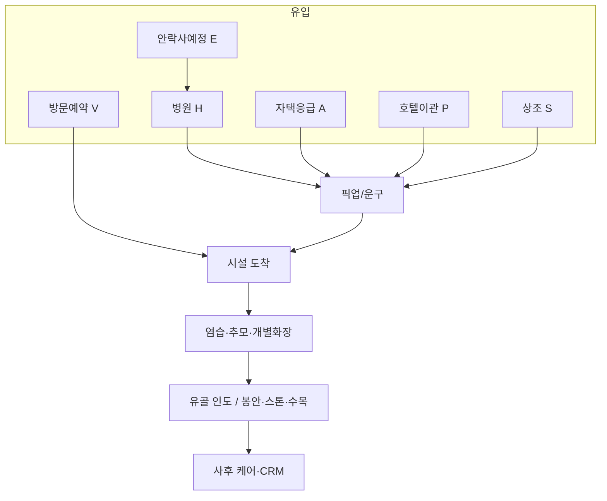

# 현재 펫장례 프로세스 (유입별)

> 목적: 시장 관행 기준의 **유입 채널별 동선·프로세스** 정리  
> 활용: 배웅 운영 SOP · 리조이스 이관 · 장례 OS(고팀장형) 상태머신  
> 관련: `펫장례_기능맵_초안.md`, `프로젝트_범위_확장_초안.md`

---

## 1. 공통 코어 프로세스 (시설 도착 이후)

유입이 달라도 **장묘시설 안**에서는 대체로 동일한 코어를 탄다.

```
상담·견적·동의
  → 접수(보호자·반려동물·체중·옵션)
  → 염습·정돈 (목욕·수의 등, 패키지에 따라)
  → 개별 추모실 (사진·유품·종교 소품)
  → 개별 화장 (참관 옵션)
  → 분골·유골함 안치
  → 인도 또는 봉안·수목·스톤 등 사후 옵션
  → 결제·영수증·(선택) 추모 콘텐츠·기일 안내
```

| 단계 | 내용 | 비고 |
|------|------|------|
| 상담 | 체중 단가, 개별화장 여부, 일정, 픽업비 | 신뢰 포인트: 허가·개별화장 명시 |
| 염습·정돈 | 단장, 관·수의 | 참관/비참관 |
| 추모 | 프라이빗 룸, 30분~ 등 | 카페형·갤러리형 시설 증가 |
| 화장 | 1:1 개별이 프리미엄 표준 | 공동화장은 유골 반환 제한 |
| 인도/안치 | 자택 보관 / 봉안 / 수목·산골 / 스톤 | 당일 또는 예약 재방문 |
| 사후 | 디지털 추모, 기일, 펫로스 | 차별화·CRM |

**당일형**이 일반적(사람 다일 빈소와 다름). 소요는 수 시간 단위.

---

## 2. 유입 채널 한눈에

| 코드 | 유입 | 비중 감(정성) | 긴급도 | 프로젝트 접점 |
|------|------|---------------|--------|----------------|
| **H** | 동물병원 (임종·안락사 후) | 매우 높음 | 높음 | 병원 제휴·픽업 |
| **A** | 자택 자연사·응급 | 높음 | 최고 | 24h 콜·운구 |
| **V** | 보호자 직접 방문(예약/당일) | 높음 | 중 | 웹예약·내비 |
| **P** | 펫호텔·위탁시설 이관 | 낮~중(성장) | 중~높 | **리조이스→배웅** |
| **S** | 상조·멤버십 접수 | 중(증가) | 중 | 제휴/자사 멤버십 |
| **M** | 병원 의료폐기물 위임 | 중(장묘와 경합) | — | 유골 미반환 경로 |
| **E** | 안락사 예정(사전 예약) | 중 | 낮(계획) | 사전 상담 상품 |

---

## 3. 유입별 상세 프로세스

### H. 동물병원 유입

가장 흔한 경로. 병원은 보통 **직접 장례를 하지 않고** 제휴 장묘로 넘기거나, 보호자가 업체를 고른다.

```
병원 임종/안락사
  ├─ [H1] 병원 제휴 업체 연결 → 병원이 픽업 요청 또는 보호자에게 업체 안내
  ├─ [H2] 보호자가 직접 장묘 검색·전화 → 업체가 병원 픽업
  └─ [H3] 보호자가 안치 후 직접 차량 이동 → 시설 방문(V로 합류)
       ↓
  업체: 병원 위치·인수 협의 → 운구 → (보호자 동행 여부) → 코어 프로세스
```

| 구분 | 내용 |
|------|------|
| 트리거 | 수술·치료 중 사망, 안락사 직후 |
| 핵심 정보 | 병원명·주소, 보호자 연락처, 체중, 냉안치 여부 |
| 주의 | 병원 “알아서 처리” = 의료폐기물일 수 있음 → **유골 반환·개별화장** 반드시 확인 |
| 소요 | 픽업 도착 통상 **1~2시간** 내(수도권·업체별) |
| OS 상태 | `lead` → `hospital_pickup` → `arrived` → 코어 |

---

### A. 자택·응급 유입 (24시 콜)

```
자택 임종 인지
  → 서늘한 곳 안치(아이스팩 등 안내)
  → 전화/카톡 24h 접수 (위치·종·체중·시간)
  → 운구 배차 → 자택 영접
  → 시설 이동 → 코어
  → (보호자 별도 차량 이동 후 합류하는 경우 많음)
```

| 구분 | 내용 |
|------|------|
| 트리거 | 새벽·공휴일 포함 예고 없는 이별 |
| 차별점 | **최단 응답·공감 스크립트**, 보관 온도 가이드 |
| 비용 | 픽업비 별도(거리·할증)인 경우 많음 |
| 고팀장 대응 | 사람 ‘긴급운구’와 유사 → 펫은 **예약형 픽업+긴급 슬롯** |

---

### V. 직접 방문 유입 (온라인·지인 예약)

```
검색/지도/후기/지인 추천
  → 웹·앱·전화로 일정·지점 예약 (또는 당일 walk-in)
  → 보호자가 아이 안치·이동 (경직 상태 그대로 이동 안내 흔함)
  → 시설 도착·접수 → 코어
```

| 구분 | 내용 |
|------|------|
| 트리거 | 자택 안치 후 낮 시간 방문, 사전 조사 후 선택 |
| 차별점 | 예약 슬롯·대기열·당일 캐파 관리가 핵심 |
| UX | 포포즈형 **날짜·시간·지점 선택** 예약이 확산 |
| 주의 | 여름은 즉시 방문 권고, 복부 팽만 시 응급 취급 |

---

### P. 펫호텔·위탁시설 이관 (본 프로젝트 핵심)

```
호텔 투숙/데이케어 중 위독·임종
  → 호텔: 보호자 연락 + 응급 프로토콜
  ├─ 병원 이송 후 H 경로
  └─ 임종 확인 후 장묘 이관
       → 동일 그룹이면 내부 Transfer
       → 타사이면 장묘 픽업 또는 호텔 차량 이송
  → 코어 (+ 호텔 이력 CRM 연동)
```

| 구분 | 내용 |
|------|------|
| 트리거 | 고령·지병 펫 위탁 중 사고·임종 |
| 차별점 | **보호자 부재** → 동의·결제·참석 일정 조율이 복잡 |
| 리조이스→배웅 | `Stay` 중 이벤트 → `FuneralCase` 자동 생성, Pet ID 유지 |
| SOP 필수 | 보호자 연락 우선순위, 병원 vs 직행 장묘, 사진·유품 인계 |

---

### S. 상조·멤버십 유입

```
상조/멤버십 가입(사전)
  → 이별 시점: 콜센터·앱 접수
  → 제휴 장묘 배정 (또는 자사 시설)
  → 픽업/방문 → 코어
  → 상조 정산(본인부담·차감) + 시설 정산
```

| 구분 | 내용 |
|------|------|
| 트리거 | 사전 가입자 사망 통보 |
| 차별점 | **전국망 배정**, 상품 범위(기본만/프리미엄) 고정 |
| 리스크 | 시설이 상조의 “하청 캐파”로만 남음 → 자체 브랜드 접수 병행 필요 |
| 예시 | 스카이펫, KT 우리펫상조, 교원·포포즈 제휴 등 |

---

### M. 병원 의료폐기물·종량제 (장묘 비이용)

장묘 유입이 **아닌** 경합 경로. 시장 추정에서 이용률을 깎는 요인.

```
병원: 사체 위임 → 의료폐기물 처리 (유골 미반환이 일반적)
또는 종량제 배출 (정서적 거부 큼, 합법이나 기피)
또는 불법 매장 (불법)
```

보호자 커뮤니케이션에서 “장례”와 “처리”를 구분해야 한다.

---

### E. 안락사 예정·사전 준비

```
수명·통증 상담 → 안락사 일정 예약(병원)
  → 동시에 장묘 일정·픽업 예약
  → 당일: 병원 절차 후 H1/H2로 연결
  → 코어 (추모 시간 여유 있게 설계 가능)
```

| 구분 | 내용 |
|------|------|
| 트리거 | 계획된 이별 |
| 차별점 | **비응급**, 패키지·스톤·영상 업셀에 유리 |
| 상품 | “이별 준비 상담” + 당일 원스톱 |

---

## 4. 유입별 비교표

| | H 병원 | A 자택응급 | V 방문예약 | P 호텔이관 | S 상조 |
|--|--------|------------|------------|------------|--------|
| 첫 접점 | 병원/보호자 콜 | 24h 콜 | 웹·전화 | 호텔 운영 | 상조 콜센터 |
| 이동 | 업체 픽업 多 | 업체 픽업 | 보호자 이동 | 내부/픽업 | 배정 업체 |
| 의사결정 | 현장·감정적 | 매우 급함 | 비교적 조사됨 | 보호자 원격 | 상품 범위 내 |
| 업셀 | 중 | 낮~중 | 높음 | 중 | 상품에 종속 |
| 데이터 | 병원 제휴ID | 긴급 로그 | 예약ID | StayID | 회원ID |
| 실패 모드 | 의료폐기물 오인 | 배차 지연 | 노쇼·대기 | 동의 지연 | 하청 마진 |

---

## 5. 상태머신 초안 (시스템)

```
[유입] hospital | home_emergency | visit_booking | hotel_transfer | sangjo | planned_euthanasia

lead / inquiry
  → scheduled          (예약·픽업 시간 확정)
  → dispatch_pickup    (운구 배차)      ※ V는 생략 가능
  → en_route
  → arrived_facility
  → in_service         (염습·추모·화장)
  → ashes_ready
  → memorial_option    (봉안·스톤·수목 등)
  → closed / aftercare (기일·펫로스)
```

취소·보류: `on_hold_guardian` (호텔이관·동의 대기), `referred_out` (캐파 부족 시 제휴 이관).

---

## 6. 영종 프로젝트 적용

| 유입 | 리조이스 | 배웅 | 우선순위 |
|------|----------|------|----------|
| P 호텔이관 | 발생지 | 수신·코어 | **P0 SOP** |
| H 병원 | 제휴 안내 | 픽업·코어 | P0 파트너 |
| A 응급 | — | 24h 콜·운구 | P0 (허가서) |
| V 예약 | 교차 안내 | 웹예약 | P0~P1 |
| S 상조 | 멤버십 번들 | 수행 시설 | P1 |
| E 사전 | 고령 펫 투숙 시 안내 | 예약 상담 | P1 |

**브랜드 톤:** 유입 상담은 ‘영업’보다 **다음 행동 1가지**(보관 → 전화 → 픽업/방문)만 명확히.

---

## 7. 한 장 요약 플로우



---

*문서 버전: v0.1 · 시장 관행 종합 · 업체별 세부는 상이할 수 있음*
